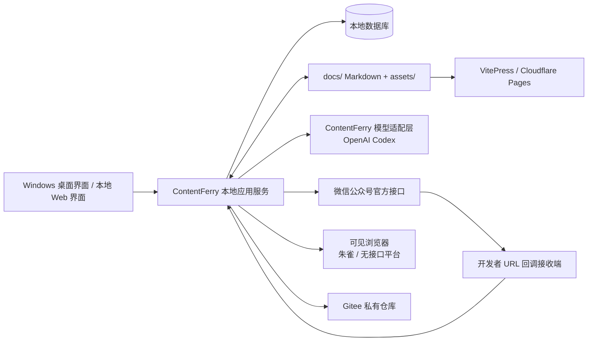
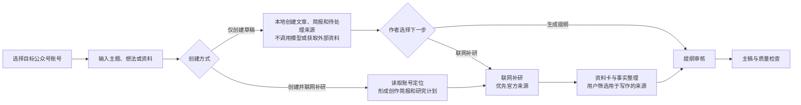
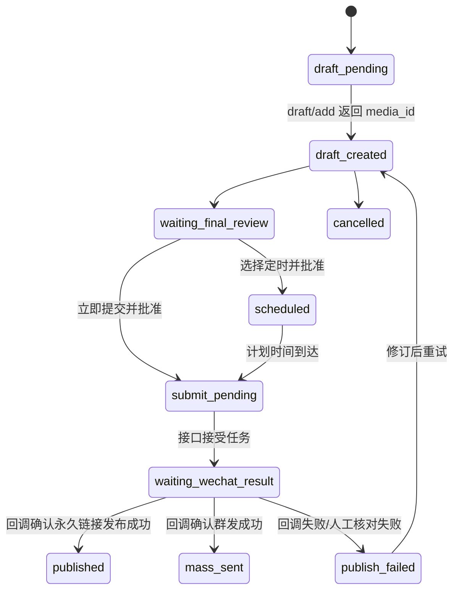

# ContentFerry 一期开发设计

> 状态：一期工程实现稿 1.4
> 日期：2026-09-29
> 依据：[产品需求文档](01-product-requirements.md)

## 1. 目标与边界

一期交付 Windows 单机版。用户从主题、想法或资料开始，AI 在已确认的账号定位与研究范围内协助创作；系统完成公众号内容质量检查、官方接口发布、结果回写，以及 CSDN、博客园和 51CTO 独立渠道稿的发布。

核心原则：

- 正文和素材保持普通 Markdown 文件；运行状态保存在本地数据库。
- 微信公众号发布以官方接口为主，浏览器仅作为朱雀检测、无接口平台和接口后备路径。
- 草稿、提交、回调确认是不同状态；接口接受任务不等于发布成功。
- 所有外部写操作可追溯、可恢复且避免重复提交。
- 一期为单写者，但所有领域对象、接口和凭据均带工作空间与媒体账号边界，为 SaaS 扩展保留空间。

## 2. 一期总体架构



`CALLBACK` 是公众号接口闭环的前置能力：必须可被微信访问、校验签名，并将事件可靠传送到本地应用。具体部署方式尚未确定，见第 8 节。

### 2.1 运行时约束

一期不预先锁死桌面框架或数据库 ORM，但实现必须满足以下可替换运行时契约：

- 桌面壳只负责启动、升级、托盘状态和窗口管理；业务逻辑必须运行在独立的本地应用服务中，使浏览器访问本地服务与桌面壳复用同一套领域 API。
- 本地服务默认只绑定回环地址，不向局域网暴露管理 API；桌面壳或本地浏览器通过随机本地会话令牌访问。
- 工作流执行器、定时调度器和回调处理器不能依赖某个 UI 窗口存活。需要定时发布时，安装包必须提供随系统启动或用户登录启动的后台代理；若代理未运行或电脑关机，任务进入 `missed_schedule` 等待用户决定重新计划或取消，绝不补发群发通知。
- 所有外部写操作通过持久化任务队列执行；UI 只能请求创建任务，不能直接调用公众号接口或浏览器自动化。
- 时间统一以 UTC 持久化、以工作空间时区显示；一期默认 `Asia/Shanghai`。

### 2.2 运行时目录与数据目录分层（已实现）

ContentFerry 同时存在两层由 Electron 管理的目录，二者独立、互不影响，不能混为一谈：

1. **运行时目录（`userData` 根）**：由 Electron 应用名（`contentferry`）决定，Windows 上默认位于 `C:\Users\<用户名>\AppData\Roaming\contentferry`。它包含两类内容：
   - **启动定位配置 `app-settings.json`**：记录用户选择的数据目录位置、首次启动标记与 AI 初始化状态。该文件必须独立于“数据目录”存在，因为数据目录本身正是首次启动向导要用户选择的目标，且需跨卸载/跨数据目录删除保留（见 `spec/04` §2）。
   - **Electron 框架运行时文件**：`Preferences`、会话存储、`Local Storage`、`Cache`、`GPUCache`、`blob_storage` 等，由 Electron/BrowserWindow 自动在 `userData` 维护，与主进程业务代码无关，**不受数据目录配置影响**。
2. **数据目录（`dataDir`）**：真正的业务数据根。默认值为 `userData/data`，可通过首次启动向导或 `CONTENTFERRY_DATA_DIR` 环境变量覆盖为任意位置（如其他磁盘）。其中包含 SQLite 数据库、技能副本（`skills/`）、内部素材、AI 沙箱、诊断日志等。

落在 `userData` 根目录的文件（配置 + 框架运行时）与落在 `dataDir` 的业务数据应当分开理解：迁移数据目录只移动后者，前者始终留在 `userData` 并随应用重新生成或重新写入。

## 3. 进程与模块边界

| 模块         | 职责                                                   | 不负责                     |
| ------------ | ------------------------------------------------------ | -------------------------- |
| 桌面/UI 层   | 内容编辑、审核、账号管理、任务进度、人工接管           | 保存业务状态、直接存储密钥 |
| 本地应用服务 | 领域规则、工作流、版本、审核、任务调度、审计           | 直接依赖某个前端页面状态   |
| 文件同步模块 | 扫描`docs`、原子写入、标题目录重命名、VitePress 兼容 | 工作流与平台发布状态       |
| 模型适配器   | 自行接入 Codex 等模型，提供研究、提纲、写作、修订和流式生成（联网检索由应用自有 WebSearchClient 承担，不绑定单一模型） | 决定最终发布或覆盖人工版本 |
| 微信连接器   | Token、草稿、永久链接发布、群发、回调映射、结果查询    | 文章主稿、审核规则的事实源 |
| 浏览器执行器 | 朱雀网页检测、无接口平台辅助、人工接管                 | 绕过验证码或平台安全限制   |
| 回调接收端   | 微信签名校验、事件持久化、可靠转发                     | 长期保存正文或明文凭据     |

微信公众号“创作来源、原创、赞赏、合集”不依赖未验证的公开 API。文章设置在创建草稿时复制到 `wechat_publish_jobs` 的设置快照（`is_ai_generated`、`declare_original`、`enable_reward`、`collection_name`）；发布记录启动浏览器辅助时只读取该快照，避免后来编辑文章设置改变一份已创建的草稿。可见浏览器先唯一定位草稿标题，再对可识别的创作来源和开关执行幂等设置；无法确定控件状态、存在同名合集或页面结构变化时不猜测、不点击，保留页面、显示接管提示并由用户完成最后预览与发布。

### 3.1 OpenAI Codex 接入边界

ContentFerry 不安装、不启动、不调用 Hermes Agent。Hermes Agent 只用于阅读和借鉴以下实现：provider 与业务流程解耦、授权状态解析、Responses 流式事件消费、取消与超时、用量归一化及可恢复错误分类。

一期在本地应用服务中实现自有模型适配层：

1. `ModelProvider` 定义能力探测、授权状态、结构化生成、流式生成、取消和用量查询。模型不支持 Markdown 流式输出时，配置适配器必须退回结构化生成，并在状态事件中说明降级；不得因缺少流式能力中断正文任务。
2. `OpenAICodexProvider` 使用 ChatGPT/Codex 订阅授权，优先基于 OpenAI 官方 Codex SDK 或 app-server 接口实现。
   Codex 推理力度按任务路由：提纲使用 `medium`，正文起草、修订、阿文自主工具工作流及其完成核验、独立内容评审使用 `high`，普通助手对话和其他结构化任务使用 `medium`；图片初审保持 `low`。这只增加复杂创作和多步决策的推理预算，不能代替可核验的验收条件、失败意见到修订任务的传递或进度检测。若更高推理力度增加延迟但没有改善实际稿件质量，应根据运行记录调整，而不是继续无差别提高所有任务的模型预算。
3. `AiTaskService` 将创作简报、研究计划、提纲、正文和局部改写转换为版本化任务，不让页面或领域仓储直接依赖 Codex 协议。
4. `ai_run` 与 `ai_run_event` 保存任务状态、输入版本引用、模型、输出版本、用量、错误和恢复位置；访问令牌只进入系统加密凭据存储。
5. 适配器不得依赖 Hermes 的进程、配置目录、认证文件、插件、技能或会话数据库，也不得把未公开承诺稳定的 ChatGPT 内部接口固化为不可替换的产品契约。

OpenAI API Key provider 与其他模型后续复用同一接口；切换 provider 不改变文章、资料、审核和发布领域模型。

### 3.2 联网补研与模型解耦

早期实现把“联网补研”硬绑定到 OpenAI Codex：实时网页检索依赖 Codex SDK 内置的 `webSearchMode: "live"`，其它 provider（`chat/completions`、Copilot）没有联网能力，`configured-model-provider.ts` 因此在调用前以护栏 fail-fast，要求补研必须用 Codex。这带来两个后果：补研无法跨模型通用，且审计看不到具体来源 URL（Codex 的检索发生在 SDK 进程内，应用只收到查询词）。

解耦方案：把“搜索 + 抓取网页”这一步改为由应用自主承担，再把检索结果喂给任意模型做综合。

- 应用自有检索层 `WebSearchClient`（`src/main/ai/web-search.ts`）：provider 注册表 + 能力标志（`supportsSearch` / `supportsExtract`）+ 回退链。Tavily（配置 `TAVILY_API_KEY` 时启用）优先，Brave、Bing RSS 与 DuckDuckGo 提供零密钥回退；任一搜索源出现反爬虫验证、格式变化、临时失败或未命中 `site:` 指定范围时，自动尝试下一个搜索源。搜索结果只用于发现页面，资料卡仍须抓取并核对网页正文。检索与任何具体模型解耦。
- 当 API/RSS 与 HTTP 检索均失败时，桌面版可追加“可见浏览器检索”后备：使用 Electron 的持久会话分区打开目标搜索页、读取已呈现的结果；如页面要求登录或人机验证，保留窗口与会话并返回 `BrowserVerificationRequiredError`，由用户完成操作后主动重试。可见浏览器检索会注入与真实 Chrome 一致的指纹（参考 gstack `browse/src/stealth.ts` 的一致性优先反检测，落地于 `src/main/research-stealth-preload.ts`：遮 `navigator.webdriver`、还原 `window.chrome.*`、对齐 `Notification.permission` 与 `hardwareConcurrency`/`deviceMemory`、清理 `__webdriver*`/`cdc_*` 等自动化全局），以降低反爬系统的误判封锁；刻意不伪造 WebGL/插件等扩展项。该伪装仅在被站点实际挑战（captcha/人机验证）时才移交人工，不得自动点击 CAPTCHA，也不得绕过任何站点访问控制。
- 多轮主动探索在两个方案中都保留，由 `ConfiguredModelProvider.webResearch` 统一编排：
  - 方案 B（通用，任何不支持工具调用的模型都可用）：由应用驱动循环；每轮让模型按 JSON 协议 `{action:"search"|"done", query?}` 规划下一步检索方向，应用执行 `WebSearchClient.search` 并累积来源。快速核实、均衡调研、深入研究分别提供 1/3/5 轮的应用检索预算；预算只是成本上限，是否仍有缺口由研究状态判断。
  - 方案 A（模型支持工具调用时优先：openai / openrouter / nous / nvidia_build）：把 `web_search` 作为函数工具暴露给模型，由主进程执行工具循环（模型发工具调用 → 应用检索 → 回填结果 → 重复直至模型停止）。若方案 A 失败或无工具调用，自动降级到方案 B。
- 研究上下文将规范化的文章标题/主题作为 `topic`，原始创作指令另存为 `creationIdea`，只用于理解用户意图和范围。方案 A、方案 B 都必须基于 `topic`、核心角度和具体缺口形成查询；原始指令中“编写一篇/公众号文章”等任务动词不得直接拼入检索词。此分离在 `AiContentService` 装配上下文，并由共享提示词明确约束，避免写作指令污染搜索主题。
- 完成条件由应用持有：综合模型返回的 `coverage.answeredQuestions` 必须逐项带原样研究问题和已核验来源 URL，应用只接受属于当前计划且能匹配已保存来源的回答，并据此关闭或保留具体问题；`coverage.remainingQuestions` 只能保留当前计划中的问题。搜索规划器返回 `done` 时结束检索；未覆盖缺口继续保持开放并标记部分调研，不为清空缺口而强制搜索。应用把本轮和可恢复前序运行的查询、结果数量及候选 URL 传入后续规划，并在执行前阻止相同或规范化后等价的重复查询；模型必须改用有实质差异的检索路径，否则停止并说明未解决的缺口。预算耗尽也保留缺口。模型只决定如何辅助检索和综合，不能自行宣告覆盖完成。
- 正文评审触发补研时，查询尝试以草稿运行的追加事件保存；恢复或后续补研读取这些事件作为搜索历史，避免因上下文重建而重复同一失败查询。事件只保存查询文本、结果数量和少量候选 URL，不保存整段网页正文或模型私有推理。
- 最终综合（synthesis）使用 `json_schema` 结构化输出，不再使用工具或 Codex 检索；模型只基于已检索来源整理资料卡，不得自行联网、不得编造链接。综合可在任意已配置文本模型上运行。
- 审计：每次补研在审计日志中记录 `retrieval` 摘要（轮数、来源条数、实际使用的检索 provider），来源 URL 现在对审计可见、可追溯。
- 当前研究状态单独存入 `content_research_plan_states`：保存结构化问题、证据维度、时效风险、待比对冲突、覆盖与缺口，以及可获得时的执行预算信息。应用检索链以轮数控制深度。`content_research_plans` 继续保存面向作者的 Markdown 结论；两者都不替代来源采纳记录。
- `research_runs` 以 `research_tasks.id` 为幂等锚点保存每次成功的初始、继续或时效刷新调研快照：计划、结论、资料卡（含正文快照和作者决定）及指定资料均序列化后只写入一次。当前研究表仍服务编辑与写作；刷新只追加不重复的新资料，失败、取消、暂停或预算耗尽不会写运行快照，也不会破坏当前资料。失败或取消任务允许设置 `archived_at` 从历史列表隐藏，但任务事件、检查点和资料仍保留，不能归档进行中的任务。应用以“刷新易变事实”的固定指令优先重核产品能力、价格、规则、版本、限额和适用条件。
- 自动资料卡不把搜索摘要当作证据：`ConfiguredModelProvider` 在搜索后逐 URL 提取正文，只有非空正文才会进入综合提示；用户指定 URL 也作为候选强制提取，成功后自动标记为已获取，失败则保留指定链接和失败原因。综合模型只能从这些正文摘录对应的 URL 中选择卡片。应用保存不超过 1600 字的正文快照、提取时间和 SHA-256，模型给出的主张、推荐理由、质量/时效与边界连同同质来源 URL 一并写入 `content_research_sources.evidence_json`。合并卡另存被合并来源的作者决定历史；手工卡保存输入摘录的同类快照，并明确标记为手工资料。卡片按证据类型和相同主张合并，没有产品层面的固定数量上限；作者决定独立存为 `adoption_status`（推荐、已采纳、已拒绝、待人工核验），刷新资料不会覆盖决定，已采纳卡的完整证据元数据会装配进提纲和正式事实检查上下文；具有自动提取网页正文快照的推荐卡还可装配进候选正文，并产生待作者确认的逐段来源关联。
- 装配：`create-server.ts` 通过 `createWebSearchClient` 注入检索层；桌面入口提供 Electron `net.fetch` 作为默认网络实现，使搜索与网页正文抓取遵循 Windows 系统代理、PAC/WPAD 和 Chromium 网络路线。作者显式配置的“检索代理”优先于系统路线，但仍独立于模型连接代理；模型代理不会被推断或继承。测试和非桌面装配可注入独立 fetch。Tavily API Key 可在“技能与模型 → 联网检索服务”中配置，使用 `AppCredentialRepository` 加密保存，并在每次检索时动态读取，因此保存后无需重启本地服务。开发环境中的 `TAVILY_API_KEY` 仅作兼容兜底；本机保存的 Key 优先。`OpenAICodexProvider` 在研究流程中仅作为综合模型使用（`webSearchMode: "disabled"`，不自行联网）；即使连接的内置搜索开关开启，资料卡仍统一经过应用检索、正文提取与证据快照保存。正文编辑器的阿文对话复用同一个 `WebSearchClient`：只有用户提出网页/官网/版本/来源核验意图时才抓取消息或正文中的最多 3 个网址，并将正文摘录和失败状态作为不可信外部上下文传给模型。
- 网页正文抓取遇到 GitHub 公共仓库文件的 HTML 页面失败或空正文时，可尝试同一仓库、同一 ref 和文件路径的官方 Raw 地址；资料卡仍保留原页面 URL，证据快照保存实际取得的正文。其他网站不作地址替换；两条路线均失败时继续报告抓取失败，不用搜索摘要冒充正文。补研规划上下文单条搜索摘要限制为 400 字，正文核验摘录在综合/增量综合上下文中分别限制为 1200 字；两种长度按实际渲染字段独立处理，不修改本地保留的完整检索结果或正文快照，避免多轮规划反复携带过长摘要挤占作者目标、已尝试路径和覆盖缺口的上下文。
- 检索请求含 `site:` 约束时，`WebSearchClient` 在接受供应商结果前核对结果 URL 的域名与路径范围；供应商忽略范围并返回无关页面时继续尝试下一个供应商，不把无关摘要交给独立评审。独立评审提出的可选公开检索若全部失败，应保留首轮结构化评审意见并新增具体的核验未完成阻断项，让候选进入补研或作者处理，不能丢失已有意见并只显示笼统的评审失败。
- **补研技能必须显式指定模型，不再默认 Codex**：`web-research` 技能的 `defaultProvider` 已改为 `null`，`ConfiguredModelProvider.webResearch` 在技能未指派 provider 时直接抛出明确提示（“请在技能与模型中为该技能选择一个模型连接”），不再静默回退到 `openai_codex`。UI 上“研究”类技能（分类 `研究`）已纳入“文本类技能”可切换模型分组（此前因分类不在任何分组中而不显示，导致用户无法改派、一直卡在默认 Codex）。补研实际使用的模型完全由用户在“技能与模型”里为该技能指派，与其直觉一致。
- 编辑器临时调研通过独立的无持久化请求接入现有 `AiContentService` 研究编排；请求必须带 `scope`（`selection`、`paragraph` 或 `article`）与有界上下文。返回证据形态结果和抓取元数据，但不得写入 `content_research_sources`、`content_research_plan_states` 或 `research_runs`。显式保存时复用资料卡写入路径，以 `pending_verification` 初始化作者决定并保留传入的证据快照；既有手工补录默认采纳的兼容行为不变。

### 3.3 通用联网找图与图片初审配置

图片搜索沿用应用侧联网边界：Tavily 是第一阶段的候选检索服务，复用“联网检索服务”中已加密保存的 Key，不新增图片搜索凭据。模型连接新增派生的 `visionInputSupport` 能力标识：OpenAI Codex 当前标记为支持，ModelScope/Agnes 的现有连接标记为不支持，自定义 OpenAI 兼容连接标记为待验证，不能静默当作支持。

图片初审设置保存在 `app-settings.json`，包括 `imageReviewMode`（`disabled`、`current`、`specific`）和可选的 `imageReviewProvider`。设置页面只允许选择启用且不是明确不支持图片输入的连接；视觉能力未知时必须在界面展示待验证与规则筛选回退说明。当前 `/api/image-candidates/search` 只启用 Tavily 的 `include_images`，不把 Bing/DuckDuckGo 的文字结果误当图片；手动搜图和阿文自动搜图共同使用 `ImageCandidateReviewService`：服务先用既有 `RemoteImageImportService` 做安全下载，再把临时文件交给已配置的视觉模型，完成后删除临时文件，不写入文章素材；单张图片初审失败时保留候选并标记失败，不能因为初审失败丢弃整次搜索。编辑器候选面板展示初审结论，但确认后才调用既有 `RemoteImageImportService` 写入文章素材；`/api/image-candidates/preview` 只为候选大图预览提供安全代理，不会写入正文或素材目录。`/api/image-candidates/history` 以 `contextKey` 为文章范围读取历史，`POST` 在搜索与初审完成后保存最终候选，数据库每篇文章最多保留最近 30 次搜索。渲染端的搜索、初审和历史保存请求绑定文章 `contextKey` 与请求序号，切换文章、关闭面板或重新搜索时取消/忽略旧结果，避免候选跨文章串用；请求超过总时限时保留可重试的错误。阿文找图时会额外调用结构化位置推荐，让模型从候选说明和文章段落中返回 `before`/`after` 锚点与推荐顺序；服务端只接受正文中唯一存在的锚点，其他结果统一回退 `end`，确认后前后保留空行插入。阿文对话输出可选的 `imageSearchRequest`，由 `AwenConversationService` 在明确找图意图下调用应用侧 `WebSearchClient.searchImages`，再通过同一初审服务完成视觉筛选，把候选、初审结果、位置建议和失败状态作为 `image_search_json` 随会话消息持久化，并同步写入搜图历史；候选返回后自动打开图片面板，下载和正文修改仍必须由用户确认；服务未返回候选时按失败处理，不显示“已打开图片面板”。主稿生成另有 `DraftImageCurationService`：正文生成后，模型结合主题、账号档案中的 `visualTraits`、已有实践截图和现有图片判断是否需要补充联网图片；若需要则调用 Tavily 搜索和既有视觉初审，只采用通过模型相关性筛选、有源网页且有唯一正文段落锚点的候选；若图片初审已启用，候选还须通过视觉初审，直接保存至本篇 `assets/`、插入正文并附来源链接，不逐张请求确认。失败时不阻塞正文生成；来源链接不等于授权证明，发布前作者仍按普通文章审核检查图片使用条件。该应用编排层是对现有模型适配器的受控工具抽象，不允许模型自行访问网络或绕过素材导入接口。自定义视觉连接按 GitHub Issue #21 继续增强。

本方案借鉴了 Hermes Agent 的“provider 注册表 + 能力标志 + 统一响应信封 + 回退链”思路，但检索工具为应用自有、网络访问不与任何模型绑定。

## 4. 核心数据模型

所有记录都包含 `workspace_id`、创建/更新时间和审计字段。单机模式固定为一个工作空间，但服务接口仍显式传递该字段。

| 对象                  | 关键字段                                          | 说明                                     |
| --------------------- | ------------------------------------------------- | ---------------------------------------- |
| `media_account`     | 平台、账号标识、人设、能力等级、凭据引用          | 公众号、CSDN、博客园、掘金或 51CTO 的具体账号 |
| `account_profile`   | 定位、读者、禁区、语气、栏目、来源版本            | 历史文章提炼后由用户确认，或由用户录入   |
| `content_project`   | 主题、创作简报、目标账号、内容状态                | 围绕一个主题的工作单元                   |
| `source_card`       | 来源类型、URL/文件、摘要、获取时间、可信/待核状态 | 用户资料、联网补研资料和 AI 推断明确区分 |
| `article_version`   | 主稿/渠道稿、父版本、哈希、Markdown 路径          | 不可变版本快照                           |
| `review_task`       | 提交者类型、提交版本、审核门、结论、意见          | 提交者为 AI、人工或系统                  |
| `workflow_instance` | 模板版本、当前状态、检查点、上下文                | 可暂停、重启恢复                         |
| `wechat_draft`      | 账号、`media_id`、渠道稿版本、草稿状态          | 公众号 API 草稿映射                      |
| `wechat_asset`      | 本地素材哈希、用途、远端素材 ID、账号、过期状态   | 封面、正文图片等上传素材的账号隔离映射   |
| `publish_job`       | 发布模式、计划时间、幂等键、提交状态、尝试次数    | 永久链接发布或群发                       |
| `publish_receipt`   | 回调事件、远端 ID/URL、最终状态、失败原因         | 最终事实记录                             |
| `callback_event`    | 接收时间、签名状态、事件指纹、原始加密载荷摘要    | 回调的不可变入站记录                     |
| `outbox_job`        | 任务类型、业务键、可重试时间、状态、锁定者        | 数据库提交后异步执行外部操作             |
| `file_sync_state`   | 文件路径、内容哈希、最后同步版本、冲突状态        | 外部 Markdown 改动检测与冲突处理         |
| `credential_ref`    | 密钥别名、加密存储位置、轮换状态                  | 不在 Markdown、日志或 Git 中保存明文     |

### 4.1 一致性、唯一性与删除规则

- `article_version` 不可修改；人工改写、AI 重写和审核页即时修订均创建新版本，并以父版本关联。
- `wechat_draft` 的唯一业务键为“账号 + `media_id`”；`publish_job` 的唯一幂等键为“账号 + 草稿 + 发布模式 + 渠道稿版本”。同一草稿不能在同一模式下被重复创建提交任务。
- `callback_event` 先落库再处理，以微信事件的稳定字段或加密载荷哈希去重；重复事件只能更新处理时间，不能重复生成回执。
- `outbox_job` 与业务状态在同一数据库事务中提交。服务崩溃后，未完成任务由租约超时回收；同一账号的 Token 刷新和草稿提交使用账号级锁。
- 媒体账号、文章和版本采用逻辑删除/归档，不能因删除账号而删除历史发布回执。凭据删除与内容删除分开执行并单独审计。
- 所有外键都包含工作空间范围校验，禁止跨账号引用草稿、素材、浏览器会话或发布任务。

## 5. 内容与文件设计

### 5.1 文件事实源

生产正文目录直接使用已配置的本地内容源；默认兼容现有 `docs` VitePress 目录，普通 Markdown 内容源也可使用同样的 `<文章目录>/index.md` 结构。首次仅做扫描和导入预览；用户确认后才写入。正文和素材使用：

```text
docs/
  posts/
    文章标题/
      index.md
      assets/
```

`index.md` 保留现有 VitePress Front Matter。`publish` 仅控制是否参与自有 VitePress/Cloudflare Pages 构建；公众号发布状态只保存在 `publish_job` 与 `publish_receipt` 中。

内容源类型、文章入口文件、素材目录和额外忽略目录集中保存在 `content_sources.source_type` 与 `pattern_json`，由 `ContentSourceService` 解释；VitePress 默认值为 `posts/<文章目录>/index.md`、同级 `assets/`、忽略 `.vitepress`，普通 Markdown 默认去掉 `posts/` 层级且不使用 `public/` 回退。Front Matter 在边界层统一读取为 `title`、`createdAt`、`tags`、`status` 等内部字段，其中 VitePress `publish` 映射为 `status`，普通 Markdown 读取 `status`；保存时保留未知字段并按来源类型生成新文章的状态字段。编辑器、AI 和发布模块不得自行拼接这些路径。

ContentFerry 新建创作时即创建 `posts/<标题>/index.md` 和同级 `assets/`，而不是等到发布时再导出。新文件沿用现有字段约定：

```yaml
---
title: '文章标题'
created: 'YYYY-MM-DD HH:mm:ss'
tags: []
publish: false
---
```

正文 Markdown 文件是唯一内容事实源，可由 ContentFerry、Obsidian 或其他编辑器共同编辑。SQLite 中的 `content_drafts` 仅作为 AI 工作流缓存和兼容旧数据使用；打开文章时必须以磁盘文件为准回读，保存时先保持原 Front Matter 和未知扩展字段，再更新正文。旧版仅在数据库中的草稿在首次打开正文时迁移到上述目录。

所见即所得编辑器禁用 Milkdown 的空段落保留插件：空段落不得在保存时变成独立的 `<br />` HTML 标签。普通段内硬换行仍按 Markdown 硬换行保存；已有文件中作者明确写入的 HTML 不由编辑器批量清除。

### 5.2 标题目录重命名

标题改变时，应用把检查目标目录冲突、目录重命名、文章文件写入和数据库上下文迁移视为一个可恢复操作：先检查目标目录，再执行目录移动和数据库事务；数据库迁移或唯一性校验失败时必须回滚目录，保留原路径、设置、搜图历史、阿文会话和记忆作用域。文件系统与 SQLite 不能共享真正的原子事务，因此若目录回滚也失败，必须明确提示用户先备份并人工处理，不能返回“已保存”。`contentferry_id` 不随目录改变。

### 5.3 隐藏运行数据

渠道稿、研究资料、审核意见、未入稿的浏览器截图和运行日志不写入 Obsidian 可见目录，保存在数据目录（dataDir）或数据库中。规划中的自主实践截图若被选入文章，则作为正式文章图片写入该文章的本地 `assets/`；只含可分享摘要的随文来源清单也随文章素材保存，完整执行记录仍留在数据目录。数据库备份与 Markdown/Git 备份一起纳入恢复清单。

### 5.4 外部编辑、冲突与 Git

- 文件监听只把稳定写入后的内容纳入同步：先等待文件写入完成，再计算内容哈希并生成候选版本，避免读取 Obsidian/VitePress 的半写入状态。
- 若本地应用和外部编辑器同时基于同一父版本改写正文，自动进入冲突状态，保存双方版本并显示三方差异；一期不做静默覆盖或自动合并。
- Gitee 同步只提交 Markdown、素材清单、非敏感配置、工作流定义和技能定义；数据库、凭据、Cookie、原始回调和私有运行日志不进入 Git。
- VitePress 构建失败不得回滚正文或发布状态，而是产生独立构建告警。`publish: false` 的文章不得进入 Cloudflare Pages 构建输入。

### 5.5 素材与公众号草稿渲染

渠道稿生成后必须经过“平台渲染包”阶段，不能把 Markdown 原文直接作为公众号 API 负载：

1. 解析 Markdown、图片、表格、代码块、引用和链接；
2. 按公众号模板生成 HTML，并在预览中显示最终 HTML；
3. 将封面和正文图片上传/复用为目标公众号账号下的远端素材，保存本地素材哈希与远端素材 ID 映射；
4. 构造草稿所需的文章字段和封面素材引用；
5. 对渲染包计算哈希，并与渠道稿版本一起冻结，供人工预览、草稿创建和回执追溯。

素材上传失败、远端素材失效或账号不匹配时不得创建草稿。AI 生成、压缩或裁剪后的素材都保留来源、版权/授权备注与派生关系。

## 6. 主题驱动创作流程



规则：

- 新建文章默认选择“创建并联网补研”；“仅创建草稿，稍后补资料”只本地创建文章、简报和待处理指定资料。此路径在创建阶段不调用任何模型或获取外部来源；工作台允许作者直接打开文章正文编辑，或主动生成提纲、启动联网补研。直接编辑读取并保存 VitePress 正文，不需要模型；AI 调用仅由明确的生成提纲或补研操作触发。
- AI 补研必须记录来源、获取时间、建议用途和与主题的相关性；资料卡保存前将 URL 统一规范化（主机名大小写、默认端口、尾部斜杠、片段和常见跟踪参数）并在同一项目内去重，避免首次补研与增量补研重复展示同一来源。检索候选也在进入规划上下文和正文抓取前按规范化 URL 去重，避免不同查询反复带入或抓取相同页面。多轮补研为可恢复的资料发现预留剩余预算：若搜索没有返回候选网页，或抓取发现候选正文为空/不可访问，将失败情况作为检索缺口交回规划器，要求换查询或来源；已尝试查询和 URL 继续去重。失败页摘要只用于规划，不能进入事实综合；只有成功抓取的正文可以成为资料卡证据。快速补研只有一轮时不额外扩大预算。当前轮与前序补研历史按查询规范化去重，单次搜索仅记录一次，避免规划器收到重复历史记录。
- 研究计划与资料卡标记用户观点、用户资料、AI 补充资料和待核查项；文章提纲只呈现读者视角的结构、判断与论证角度，不混入检索任务或作者指令。当前实现把检索交给应用自有 `WebSearchClient`（Tavily / Brave / Bing RSS / DuckDuckGo 回退链），再由 `ConfiguredModelProvider.webResearch` 在任意已配置模型上完成多轮检索规划、正文核验与综合，将研究计划与资料卡写入 SQLite；正文生成模型调用默认不直接使用联网搜索工具；生成前的读者承诺缺口核对，以及独立正文评审发现的具体事实缺口，可经正式补研流程继续搜索、抓取并核对网页正文。已采纳卡和已核验待确认候选卡都是可用依据，不构成封闭资料集。自主实践会在起草前结合目标、提纲、现有资料和账号风格评估是否有帮助；执行本机或网页操作仍走实践工作流，并受当前任务授权、权限和无进展护栏约束，不能由卡片或模型提示绕过。资料卡必须保存直接 URL、标题、短摘要、具体主张、来源类型、获取时间、证据快照与作者采纳状态；作者可将错误聚合的卡按正文快照拆分，或合并同一主张的卡，操作会保留来源、主张和采纳决定。已采纳卡进入提纲和正文上下文作为已确认依据；正文已抓取并核对快照的推荐卡也可作为候选正文依据，同时保留待作者确认状态和逐段来源关联；待核验、拒绝或无正文快照的卡不会进入候选事实。提示只提供相关事实和引用候选，不会自动把脚注、外链或归因写入公开正文；手工补录链接只允许不带凭据的 HTTP(S) 地址。`content_specified_sources` 独立保存用户明确提交的 HTTP(S) 链接，按规范化 URL 在项目内去重，状态为 `pending_manual_verification`、`verified`、`rejected` 或 `failed`；后两类人工结论分别要求核验说明或失败原因。它们不会进入 `content_research_sources` 或写作上下文，直至正文核验步骤形成资料卡。增量补研使用独立 `research/follow-up` 调用：保留既有资料和用户勾选状态，按规范化 URL 去重后追加新资料，并把补研指令与结论写入同一 `source:<relativePath>` 阿文会话。资料窗口还支持用户手工补录标题、摘要、关键主张和可选来源链接，供后续提纲和正文使用。首次补研和增量补研现在都会先创建 `research_tasks` 记录，并将请求、运行状态、心跳、检查点、取消请求和追加事件写入 SQLite；暂停不会中断已经发出的联网请求，结果返回后先写入不可变 checkpoint，再继续会优先消费该结果，避免重复联网；SSE 进度携带 taskId，用户可在资料窗口暂停、继续或停止当前任务，已保存资料不回滚；客户端断开 SSE 后，当前请求仍会继续完成并保存结果；应用重启时，过期的 `running` 任务会重新排队并由单进程恢复器续跑。官方来源白名单和精确引用映射属于后续增强。
- 对 AI 提交物，审核者可以直接修改后批准，或要求 AI 在当前审核页修订；只有实质性返工才退回研究或提纲节点。
- 提纲生成提示和独立评审提示共同处理提纲信息密度：复杂指南必须能从各节定位读者问题与内容方向，只有宽泛标题且无法支持后续起草时提出结构修订；不设固定要点数量，简单主题仍可简洁。运行时使用提纲专属结构化评审输出，要求评审逐节说明读者问题、章节作用、关键内容要素、充分性判断和本节原文依据；缺项、章节不匹配或依据不能在对应章节定位时，确定性地补充修订 finding，避免模型只返回“通过”而漏掉标题式提纲。
- 正文生成提示必须把已采纳资料卡当作可用事实素材，而非可选背景或逐张覆盖的清单：按章节读者任务挑选能实质支撑判断的具体事实、做法、评价、限制或反例，不为使用资料而罗列；同时区分官方说明与第三方观点，遵守卡片的质量、时效和证据边界，不自动写入 URL、脚注或资料列表。资料卡只是已有材料，不构成封闭证据集；若读者承诺需要当前事实或本篇实践观察，运行时仍由补研和实践编排路径处理，不能用卡片存在作为跳过后续工作或终止审查的理由。
- 正文写作与独立评审按事实类型分配依据强度：稳定、广泛成立的概念解释和一般原理可基于可靠通用知识表达，不要求逐句联网或资料卡；不得把模型记忆标成刚刚核验的来源。当前版本、命令参数、官方要求、兼容范围、价格、政策及其他易变或高影响结论优先依据本篇已核对网页正文或权威来源；作者经历、本机状态、运行结果和数量必须来自作者记录或本篇实践观察。不能核实时，只对会影响读者结论的具体缺口补研、缩小范围或标待核查，不把整段稳定背景写成占位符，也不为消除所有一般解释而强制搜索。
- OpenAI 兼容模型的结构化正文若因输出截断而形成不完整 JSON，第二次请求使用正文专属的完整章节要求和更高的输出额度；研究资料卡的短摘要约束不得泄漏到正文重试。若模型仍无法返回完整对象，应显式失败并保留原候选，不把压缩或残缺的正文视为通过评审。
- 正文以一次面向完整提纲的连贯生成请求起草，模型同时获得完整读者承诺、篇幅计划、已核对资料和本篇实践观察，避免章节间只靠摘要传递而造成割裂。提纲是覆盖承诺而非内容上限：保持已确认范围和二级章节标题，允许根据读者任务扩展有用的三级标题、解释、示例、操作步骤、比较和故障处理；新增的时效事实与本篇观察仍须有核对资料或实践记录支撑。具备流式输出的模型逐步返回完整 Markdown；服务端即时推送正文增量，并按字符阈值及结束/中断边界保存候选检查点和活动事件。无流式能力的模型在完整正文返回后保存候选，不伪称实时输出。生成中断时保留实际收到的候选文本，标记未完成，跳过配图和整篇评审；完整初稿完成后再配图、独立评审、补研和实践复评。恢复已保存候选时不重复生成初稿或自动重做配图。
- 正文评审按确认提纲逐项验证读者结果，并要求对应章节提供可定位原文。若承诺明确要求命令、代码或脚本，运行时还要求该项引文含 Markdown 行内代码或代码围栏中的具体片段；泛称“运行命令”不能通过，命令缺失转为补研而不是让纯文字修订猜写。
- 独立正文评审上下文必须包含创作简报中的作者资料、观点与经历，并显式标记为作者输入：仅支持作者明确写出的经历或观点，不自动核验其中的公开事实。作者输入、研究卡、实践观察、已确认账号风格分别传入，不能互相替代；评审提示不得只因 `sourceNotes` 非空就把它当作任意第一手主张的依据。
- 正文生成响应分开携带 `styleSelectionNote` 和 `imageCuration`。风格选择提示只允许说明本篇的表达与结构取舍；配图结果使用独立状态 `added`、`not_added` 或 `unavailable`，并返回有界简短原因。配图偏好是候选选择的参考，不是每篇文章的硬性要求；缺少实践截图不能单独作为拒绝联网配图的理由，也不能作为评审缺陷。渲染层将风格说明和配图处理结果独立展示，评审仍由 `generationReview` 与顶部评审摘要显示，禁止把这些状态拼成一段文案。
- 候选稿保有与确认提纲一致的多个二级章节时，正文评审的文字修订、补研后的事实更新和实践后的观察更新走局部替换协议：模型仅返回有界 `edits[{original,replacement}]`；运行时要求原文在当前候选中唯一出现、各修改互不重叠、不跨多个二级章节，且一级标题与涉及的二级标题保持不变。无效替换不写入候选，返回具体失败原因；纯文字修订返回空修改则由编排器判定无进展并停止重试。纯文字修订后若独立评审的意见、严重度、处理方式、问题描述和正文依据全部未变化，即使候选其他位置有改动，也停止后续修订并保留最新候选及具体原因；只要评审状态或依据发生变化，仍可使用剩余修订预算。补研或实践回调只在取得新增已核对证据时返回候选，因此即使正文没有改字，也要用新证据重新独立评审一次；同一缺口以键去重，避免重复获取。结构缺失或单章节候选暂沿用完整正文修订，再由独立评审复核。来源与实践记录仍由原有逐段关联和独立评审校验，局部替换本身不等于事实通过。
- 同一轮评审同时返回 research/practice/scope_decision 与 revision 意见时，先尝试可执行的证据工作；若未取得新证据，不得因此丢弃独立可修的编辑意见。编排器只把 revision 子集交给文字修订器，并继续复评完整候选；未解决的证据 finding 仍保留，不能被文字润色消除。相同编辑意见及正文依据重复出现时停止该修订路线，避免与证据缺口一起空转。
- 提纲生成与独立评审按主题复杂度共同规划读者任务，并保持文章主题与作者要求的文章类型、范围和读者结果之间的对齐：相邻子问题可作为论据或章节，不能取代明确承诺的主要结果，除非简报明确选择该窄目标。复杂指南/实践主题需在各节列出关键读者问题和内容要素，形成可供正文展开与评审核对的承诺；不设固定要点数量，提纲不得限制正文为兑现承诺所需的扩展。简单主题可保持简洁，不能机械套用模板。
- 评审修订循环跨轮保留已处理的问题历史；相同标题或相同正文证据锚点再次出现时，把上一轮处理方式和未解决原因传给修订模型，即使中间先处理了其他意见或评审更换了标题。停滞判断基于问题身份与证据锚点，不把措辞变化当成进展。
- 提纲编辑的暂存版本单独写入 `content_outline_drafts`，不参与 `outlineReady` 判断；正式确认通过现有提纲保存接口写入 `content_outlines` 并清理暂存，重新打开提纲时优先恢复暂存版本。
- 提纲优化使用独立 `outline/refine` 请求：客户端发送当前未保存 Markdown 和作者指令，服务端返回完整建议，不直接写入 `content_outlines`。用户应用建议后才更新本地草稿；客户端保留应用前内容供一次撤销，保存提纲仍走现有 PUT 接口。该请求默认关闭联网检索，仅装配创作简报和已采纳资料上下文。
- AI 提纲生成采用“生成候选 → 独立评审 → 有界修订 → 作者确认”。`ContentReviewOrchestrator` 持有通过/继续/需作者处理的循环控制；提纲专用上限为五轮自动修订，正文和渠道稿默认仍为三轮。提纲评审按读者目标、开篇价值、中心判断/任务路径、章节独立信息增量、资料覆盖和账号风格逐项检查。提纲提示不规定每节要点的固定数量；章节可按内容需要用一句话概括或分组展开，避免为了格式一致而凑点或压缩实战清单。要点直接表达读者将获得的答案、判断、操作路径或边界；运行时会额外拦截以“说明、介绍、提醒、给出”等作者待办为主、或主要让读者去外部文档寻找答案的章节，即使模型评审误判为通过也要求修订。若核心读者任务依赖具体命令、步骤或前提，运行时即使只发现一个外部文档转交要点，也会要求提纲规划正文要提供的操作路径，避免“多数要点”阈值放过关键缺口；检测与回归测试覆盖自然语言变体（例如“按官方安装说明操作”），避免只匹配固定句式。提纲阶段可以留下待补研的问题，不要求预先提供证据或具体事实；正文仍可继续补研。提纲阶段尚未取得实际实践观察本身不是评审问题；需要实测的文章可先安排读者视角的章节和验证目标，具体观察留到正文起草阶段。阻断问题与可执行的待改进意见都会触发修订，只有评审没有遗留意见才通过。纯属个人偏好的可选润色不应列为评审意见。候选只在整轮完成后写入编辑器，避免未评审的流式内容被误认为可确认。
- 提纲评审除已采纳资料和风格档案外，还会收到创作简报里的作者想法与资料，核对提纲是否把个人使用、测试、观察或本机结果写成没有对应依据的既有事实。运行时会检查作者材料是否指向同一软件/对象或操作；仅有非空备注、链接、背景信息或无关经历不能通过硬性检查。无对应依据的亲历说法会追加 blocker，即使模型评审误判通过也必须修订；风格档案和历史文章样本只描述表达习惯，不能证明作者经历。无依据的亲历说法应改成正文阶段待验证的问题或一般读者场景。
- 提纲评审除逐节 `sectionCoverage` 外，必须返回 `briefAlignment`：作者要求的交付物、读者结果、承载章节标题及提纲原文依据。运行时逐字核对章节标题与证据引文；评审判定错位，或声称对齐但引用无法定位、未提供有效章节时，均追加全文目标 blocker，防止每节看似具体却整体没有兑现用户目标。
- 内容评审使用单独注册的 `content-review` 技能，提示规则位于 `assets/skills/content-review/SKILL.md`，用户可在“技能与模型”编辑该文件并为评审单独选择模型。提纲、正文与渠道稿调用在动态上下文中标明阶段；静态评审标准不再硬编码在生成服务中。提纲评审明确允许将实际实践安排在正文阶段；正文评审才检查实践结论是否有本篇观察支持。评审可以启用所选模型支持的公开网页搜索；文章、资料卡和搜索结果都包在不可信数据边界内，搜索结果只记录在评审报告中，不写入正式研究资料或正文。评审没有直接修改文件、发布内容或扩大任务授权的能力。
- 通用工具工作流完成条件使用独立的 `goal-verification` 技能及其可编辑规则文件；它默认继承 `awen-assistant` 的模型连接，但作者可在“技能与模型”单独选择另一个模型，以减少执行者与核验者共用同一模型时的判断偏差。核验调用只接收目标、候选答复和已有观察，不注入阿文工具，也不能请求或扩大授权；技能停用或核验调用失败时保持 fail closed。
- 正文评审提示还投影研究计划尚存的有界缺口，明确它们可能已过时，须与当前正文、资料和读者目标核对后才形成 finding。评审沿文章承诺的读者任务检查核心步骤和判断方法；“去官网查看”若替代文章承诺的关键操作，应路由到正式补研、实践或作者范围决定，而非当作事实谨慎便直接通过。普通背景解释不因此强制新增来源或实测。
- 主稿正文评审除一般 findings 外，须为深度计划中的每个提纲承诺返回一项覆盖记录（章节、原承诺、covered/partial/missing、解决路径、具体读者结果和正文引文）。模型须区分提到主题和回答读者问题，按承诺类型判断必要解释、步骤、取舍或论据，不设置统一字数门槛。运行时逐项核对承诺集合是否完整且唯一，并检查 covered 引文是否按原文字词与标点出现在对应二级章节正文；只忽略 Unicode 规范化及空格、换行等排版差异。评审必须说明读者实际得到的理解、判断或操作结果；未兑现承诺的该结果会随 blocker 一同传给修订模型。遗漏、重复、提纲外项目、章节引用错误或不可定位引文都会转成 blocker，不能因模型只返回空 findings 而通过。运行时还会拦截明确把核心内容推迟到官网查阅、后续实测或保留未完成占位符的覆盖引文；当提纲明确承诺本篇的实测、操作或运行结果时，也会拒绝用“本篇没有实测记录”等否定观察的原文证明承诺已完成，并按实践缺口路由。这包括“开始操作前再打开官方页面核对步骤”一类把关键答案留给外部页面的表述，并按资料或实践缺口路由，不允许这类文字单独证明承诺已兑现。语义上的“充分兑现”仍由独立评审模型判断，字符串核验只确认引用确实来自指定章节；这类确定性检查是额外护栏，不替代语义判断。
- 每次新起草且有正式补研入口时，正文生成先以一次有界结构化模型调用比较已确认提纲的读者承诺、调研计划线索、已采纳及已核对候选资料；最多输出 3 项仍阻碍核心读者任务的网页资料缺口。只有非空结果才调用既有正式补研入口；获得新网页正文后刷新起草上下文，并用原有问题再核对一次，不能因新增了任意无关来源就清除缺口。调用失败、没有新资料或仍有关键缺口时继续生成候选供作者查看，但保留未解决缺口，最终状态不能被正文评审的空 findings 误标为通过。实践目标不经此联网预检替代，仍走现有实践授权流程；同一新起草最多发起一次预检补研，续审不重复触发。
- 多轮评审使用阶段专属的资料投影，避免反复携带整份研究卡：提纲评审与修订只带来源标题、URL 和有界关键主张；正文评审另带有长度上限的摘要与证据边界；搜索结果摘要也按条截短。当前候选提纲/正文和结构化评审意见仍会随各轮传入，因为它们是复核与修订所必需的。模型供应商可能提供前缀缓存，但应用不依赖缓存来保证正确性或延迟。
- 主稿和实质改写后的渠道稿复用同一有界评审编排器，但分别按 `content-review` 技能中的正文/渠道稿规则评审。评审模型可在“技能与模型”独立配置，不继承生成器的上下文或结论；评审者可以在当前任务既有范围内进行公开网页检索。主稿评审核对创作简报、已确认提纲、采纳资料和实践观察；渠道稿评审核对源文章、平台与账号约束。评审模型提出的多个查询逐项执行；单个查询失败时保留其他查询的结果，并把失败查询作为未核验状态交给评审，不直接丢弃已取得页面。只有全部查询均无可用页面时，才将公开核验标为未完成。评审搜索证据留在评审报告，不自动写入资料库、正文或渠道稿。渠道稿仅 `generation_mode = 'rewrite'` 进入评审，`source` 模式直接复用主稿，不重复调用评审。
- 联网研究与评审技能按具体事实主张选来源：优先能直接证明该主张且适用于目标版本、平台和配置的一手资料，并保留时间与适用条件。来源冲突时应尝试找到版本差异、文档滞后或配置前提等解释；无法解释就把冲突和不确定性传给作者，不自行合并成确定结论。社区教程、Issue 与个人报告适合发现边界和反例，不单独证明普遍行为；第三方脚本和镜像须核验维护者、来源及安全影响。每次核验失败都把具体缺口、已尝试来源/查询及所得观察带入下一步决策，选择有实质差异的新路线，或说明没有适用路线并停止；运行时已有重复查询与无进展护栏继续兜底。此规则是通用证据策略，不增加某个领域的固定模板。
- 完成核验成功但引文无法在作者原始请求或工具观察中定位时，运行时先用原始来源执行一次核验引文修复。修复仍不成功时，如果还有工作流预算，就把审计结果交给下一轮阿文：优先基于已有观察生成可核对的答复，证据缺失时才选择不同路线；不得重放已完成调用。验证事件照常计入无进展判定，连续相同缺口仍按现有阈值停止，结束状态保留具体核验器缺陷与候选答复。核验服务/结构化输出调用本身抛错仍作为服务故障单独呈现，不以内容重规划掩盖。
- 阻断项和可执行的待改进意见都会触发有界的“修订后重新评审”；提纲最多五轮，主稿和渠道稿最多三轮。每轮修订只收到原文章依据和评审意见，不能使用评审阶段临时搜索结果扩写文章事实。若上一轮自动修订后同一条意见仍然存在，运行时会把此前未解决的意见和“上一处理未通过”的纠正指引附到下一次修订请求，要求模型定位根因、调整处理方式；最终报告仍保存独立评审的原始意见。判断意见是否重复时优先用同一解决路径下的规范化标题；标题改写时若正文证据引文完全相同，也视为同一问题，不能把严重级别、详情措辞或评审摘要变化当作进展。常规正文/提纲修订允许模型基于反馈再尝试一次；连续两次复评仍是同一组问题时提前停止并保留最新候选，避免把全部修订预算耗在同一缺口上。若候选未变化、补研/实践没有新观察、修订失败或评审调用失败，则按对应失败路径立即停止，不额外重试。达到对应上限仍有遗留意见时，保留最新候选并把状态设为 `needs_author` 或 `review_failed`，向作者展示报告；这些结果不标记为通过。通过结果没有遗留 findings。主稿和渠道稿在生成流程中完成评审后再交给作者编辑/确认，人工改动会使评审记录按 Markdown 指纹派生为过期，但不会阻止作者继续编辑。
- 正文流式接口在独立评审完成前不发送未审候选；评审完后一次性发送正文内容和评审摘要，避免渲染端先展示为可用稿再回滚。评审进度只报告生成、检索、修订和复核阶段，不转发模型私有推理。
- `content_generation_reviews` 以追加方式保存项目、内容类型、SHA-256 版本指纹、评审状态、修订轮数、评审报告和时间。读取时把记录指纹与当前 Markdown 比较并派生 `stale`；作者编辑不会篡改历史记录。新表由 schema migration v8 建立；v9 将 `repair_rounds` 的约束扩展到 0–5，以匹配提纲评审的最大修订轮数，并保留旧记录。迁移按数据库升级流程先备份，并执行外键检查。
- 正文起草以 `article_draft_runs` 保存运行状态、篇幅选择、范围、提纲/正文哈希和安全检查点；`article_draft_run_events` 以递增序号保存阶段进度、配图结果、结构化评审路由和终态。schema migration v10 新建两表并为 `content_briefs` 增加可空 `draft_depth_preference`；v11 按实际表结构修复曾记录 v10 但缺少该列的开发库；v13 新建 `article_draft_candidates`，按运行 ID 保存尚未获准入稿的候选 Markdown 与校验哈希，用于授权等待和中断后的续审。候选稿与正式文章及 `content_drafts` 分离，保存候选不会把文章标记为已起草。从受支持历史库升级时先做一致性备份，在事务内记录迁移并执行外键检查。每次独立评审返回后立即保存候选版本并追加 `review_completed` 事件，记录候选哈希、评审轮数、发现数量及有界的逐项意见；每次修订或基于新证据的修改后立即更新候选检查点并追加 `checkpoint_updated` 事件。由此重启或失败恢复会从最新修订候选续审，作者也能在执行活动中对照各轮意见与改动；事件不保存正文、完整工具输出或模型私有推理。服务启动时将遗留 `running` 任务标记为需作者核查，并保存当时文章与提纲哈希、当前已采纳资料卡 ID、关联实践任务/工作流状态及待授权是否需要重新确认；这只是恢复核对快照，不代表权限获批。作者续审时再读当前文章、资料与实践结果，不自动续跑或重放调研、实践及授权操作。
- `draft-depth-planner` 保留作者精简/标准/详细偏好；未指定时标记为 `adaptive`，把写作目标、目标读者和提纲承诺交给生成与独立评审共同判断详略：指南与实践内容按需写清前提、操作、结果判断和边界，概念与观点内容充分展开解释和论据但不套用教程结构。单项承诺若包含多个判断、步骤或适用条件，生成与评审都不得凭一句提及视为兑现，须按读者实际完成理解、行动或核验所需的信息分别展开。该计划不按标题关键词推断体裁，不设置阅读时长或字符预算；显式篇幅偏好会转成对应的执行指导。从提纲各节提取的读者承诺仍供生成与独立评审使用。实践评估仍由现有文章实践工作流在正文生成前完成；正文评审的 `resolution` 为 `research`、`practice`、`revision` 或 `scope_decision`。`revision` 最多进入三轮纯正文修订。`research` 会经正式补研任务在既有预算内抓取网页正文，只有新增可核对快照才刷新候选来源上下文、修订受影响段落并独立复评；相同缺口不重复无进展调用，最多两轮不同缺口的补研。若新资料或新实践已经进入候选并完成复评、同一缺口仍未解决，运行时停止重试并在结果中说明“已有新观察但同一缺口仍在”，不把新观察误称为通过依据。推荐卡保持未采纳状态，模型来源映射与作者确认仍独立。研究任务及正文运行记录分别保存检查点，取消后不写入未完成资料；重复 URL 可刷新未确认推荐卡的网页快照，不覆盖作者已采纳或拒绝的卡。`practice` 在流式正文任务中会保存候选稿，创建或续接本篇实践任务，沿用现有授权边界；工作流取得新的实际观察后刷新实践上下文，仅修订受影响段落并独立复评。授权等待写入运行事件；失败、拒绝或无新观察时停止并保留候选。应用重启后可由作者从已保存候选主动续审；作者确认范围调整后会修订并复评；`scope_decision` 继续由作者处理。
- schema migration v12 新增 `article_research_links`，以正文事实片段、所在段落哈希、支持摘录和网页快照哈希保存候选来源关联及作者决定，不复制文章正文。只有 `recommended` 且非手工摘录、具有正文摘录、抓取时间和全文 SHA-256 指纹的自动提取卡片可进入候选正文；`adopted` 仍用于提纲已确认资料。来源映射由独立结构化模型调用产生，服务端核对来源归属、摘录逐字存在和正文唯一段落后保存；无效关联使本轮评审保持待作者处理。编辑器通过当前未保存正文查询关联状态，段落变化或来源失效标为 `needs_recheck`；作者重新核对并确认时服务端再次检查唯一段落和原网页快照指纹，来源失效则拒绝确认。删除原表述后界面不再展示旧关联，数据库仍保留决定记录。渲染层只在所见即所得视图给对应段落加视觉标记，并在“资料来源”面板显示支持摘录、原链接及确认/拒绝操作；标记不写入 Markdown。旧库升级沿有序迁移与一致性备份流程，原文章、资料卡和作者决定不改写。
- 正文候选先经可选配图筛选，再对同一最终候选独立评审，保证评审哈希覆盖插图后的 Markdown。`image_curation` 事件记录 inserted/not-needed/no-candidate/rejected/placement/service-unavailable 及有界原因；候选源 URL 与唯一锚点可靠性由图片服务判定。右侧活动面板按事件序号显示追加历史；SSE 断开后可通过 latest 与 events 游标端点续读。完成状态仅在评审通过时为 `passed`，其它评审意见保留为 `needs_author`。
- 提纲确认路由拒绝存在未通过评审记录的候选；已通过记录即使因作者编辑而过期仍允许作者确认，同时界面明确提示记录对应旧版本。作者可发起重新评审，重新评审结果会形成另一条记录。

正文候选的范围调整入口已接入流式起草：接口接受 `resumeCandidateRunId` 和可选 `scopeAdjustment`（20–1200 字）。只有候选哈希、原提纲与正式文章基准匹配，且该候选最新独立评审为未过期的 `needs_author` 并含 `practice` 或 `scope_decision` 意见时，才接受作者的新范围。决定原文写入新运行的 `scope_json`，事件只记短状态；先修订候选正文，再按调整后的读者承诺独立复评。再次续审继承已确认范围，但不重复范围修订或配图下载；若仍缺资料或实践观察，继续按既有补研、授权和停止规则处理。原运行、候选和评审记录均保留。
在同一篇实践任务的最近一次方向事件为作者明确的 `draft_with_gaps` 时，正文评审的 `practice` 路由记录跳过原因，不再立即开启追加实践。后续有 `goal_added` 或新的实践方向事件时才重新考虑实践；这一判断基于追加事件而非旧任务曾经有过缺口的永久标记。

### 6.1 Agent 与技能执行契约

正文运行的最新记录接口同时返回其独立持久化的候选 Markdown、当前提纲及正式文章的哈希匹配状态；工作台在正式草稿尚未保存时恢复候选到编辑器，并把它标为未保存。运行开始时记录正式文章哈希；重启协调只记录恢复时的文章哈希，不覆盖候选正文哈希。恢复只读取现有正文、检查点和事件，不发起模型或工具；本次恢复不产生新的评审结论。若提纲或正式文章已改动、原运行缺少文章基准，界面提示重新核对，并拒绝自动续审。作者主动点击“从候选继续评审”时，新建引用旧运行 ID 的运行，以候选为输入，重新读取当前资料和实践观察并独立评审；不调用初稿生成或配图下载。新缺口仍经过当前预算和任务授权处理；被中断的单个工具步骤不会自动重放。实践检查点的更细粒度主动恢复仍待实现。

- 每个 AI 节点固定记录所用技能版本、模型/Agent 提供方、提示模板版本、允许工具、输入资料版本、输出结构、Token/费用和执行日志摘要。
- 研究、提纲、写作和修订技能必须输出结构化结果；例如研究输出“候选资料卡 + 来源 + 待核问题”，提纲输出“章节 + 论点 + 来源引用 + 风险”。解析失败不能直接进入下一节点。
- 网页、文件和外部消息属于不可信输入；技能不得执行其中嵌入的指令，也不得因页面文字要求泄漏凭据、修改工作流或发送内容。
- 远程图片导入在主进程/本地服务执行，不由渲染进程直连绕过 CORS。导入器只允许 HTTP(S) 公网地址，逐次校验重定向目标，拒绝 loopback、私有、链路本地、保留网段和带凭据 URL；限制 3 次重定向、30 秒和 15 MB，并以文件签名确认 JPG、PNG、GIF 或 WebP 后才写入文章 `assets/` 或项目素材库。
- AI 只能创建建议、版本和待审核任务，不能直接调用草稿提交、群发、删除远端内容或修改凭据。
- 网络检索、浏览器使用和文件写入由技能声明的工具白名单控制；用户可在执行前看到权限范围。

### 6.2 质量规则与例外发布

质量检查输出规则编号、风险等级、命中的文本范围、依据版本和建议动作。腾讯朱雀 AI 特征偏高默认只产生风险提示或二审任务；用户继续发布或例外发布时，系统必须将检测结果、理由、二次确认和最终内容版本关联到 `publish_job`。

## 7. 微信公众号发布设计

### 7.1 发布模式

| 模式         | API 语义                                  | 用户界面文案               | 主要限制                               |
| ------------ | ----------------------------------------- | -------------------------- | -------------------------------------- |
| 永久链接发布 | `draft/add` → `freepublish/submit`   | 发布永久链接（不通知粉丝） | 不进入历史消息；提交成功不代表最终成功 |
| 群发通知     | `draft/add` → `message/mass/sendall` | 群发通知粉丝               | 受账号类型和剩余额度限制               |

用户必须主动选择模式。不得把“永久链接发布”显示成“已推送给粉丝”。

### 7.2 状态机



`errcode=0` 只允许状态转移至 `waiting_wechat_result`。只有已验证的回调事件或人工核对/回填可进入 `published` 或 `mass_sent`。

### 7.3 Token、幂等与回调

- 每个公众号账号独立缓存 `access_token`；默认提前 5 分钟刷新。
- 同一账号的 Token 刷新采用单飞锁，避免并发刷新令旧 Token 失效。
- 每个提交任务有幂等键，包含账号、草稿 `media_id`、发布模式和渠道稿版本。
- 回调接收端验证微信签名，保存原始事件摘要和接收时间，再映射到对应发布任务。
- 回调重复到达时按事件 ID/业务键去重；未知事件进入人工处理队列。
- 草稿删除只能在最终回执确认后执行，且默认需要用户显式选择。

### 7.4 定时发布

定时任务保存目标账号、草稿 `media_id`、发布模式、渠道稿版本、最终审核结论和计划时间。触发时重新校验 Token、账号状态与群发频率规则；用户可在触发前取消或重新审核。

若后台代理未运行、计算机休眠/关机、出口 IP 未通过白名单预检或最终审核已失效，任务不自动补发：标记为 `missed_schedule` 并通知用户重新计划、立即提交或取消。群发通知永远不得在错过计划时间后静默补发。

### 7.5 回调安全与处理顺序

生产回调使用安全模式；明文模式只可用于连通性原型验证。处理顺序固定为：

1. 校验请求方法、时间窗口与微信签名；
2. 安全模式下校验 `msg_signature`，解密载荷并验证 AppID；
3. 在单个事务内写入 `callback_event`、计算事件指纹、完成去重和标记待处理；
4. 成功持久化后才向微信返回成功响应；
5. 异步消费者将事件关联到 `publish_job`，生成 `publish_receipt` 并推进状态；
6. 无法关联、解密失败、重复事件或未知事件进入人工处理队列，原始敏感载荷按最小保留原则加密保存。

回调公网入口不能把管理 API 暴露给互联网；它只接受微信回调路径，并设置请求大小限制、速率限制、签名失败审计和告警。

### 7.6 失败分类与人工恢复

| 分类 | 示例 | 默认动作 |
| --- | --- | --- |
| 可重试 | 网络超时、短暂 Token 失效 | 有上限的退避重试；使用原幂等键 |
| 待外部结果 | 接口提交成功、等待回调 | 等待；超时后核对或人工回填，不重新提交 |
| 需人工处理 | IP 未白名单、验证码、原创声明失败、平台审核拒绝 | 暂停并显示原因、版本和下一步 |
| 不可恢复 | 凭据被撤销、账号权限缺失、草稿已删除且无可用版本 | 终止当前任务，保留证据并允许从安全节点重建 |

草稿、提交和回调各自独立记录；人工“重试”必须显示将重试的精确动作，禁止一键从头重复整条发布链路。

## 8. 公众号接口部署前置条件

Windows 单机应用调用公众号接口前，必须通过验证清单确认：

- 客户端当前出口 IP 可加入公众号后台白名单；动态 IP 变化后由用户更新白名单并完成应用内预检；
- 微信可访问开发者 URL 并将最终结果事件送达；
- 回调事件能可靠传回本地应用；
- AppID、AppSecret 和回调校验信息可安全保存；
- 账号具备目标 API 与群发能力。

需要在以下方案中选择并验证其一：

1. Windows 主机使用当前出口 IP 白名单和可访问回调地址；IP 变化后用户手工更新白名单并重新预检；
2. Windows 主机使用固定公网出口和可访问回调地址；
3. 用户自管安全中继/回调服务，提供固定出口与事件转发；
4. 其他满足白名单和回调要求、且不保存用户正文与明文凭据的部署方案。

动态网络可作为一期支持路径，但每次出口 IP 变化后必须由用户更新白名单并通过预检；在此之前不承诺接口发布可用。固定出口或安全中继属于后续稳定性增强方案。

## 9. 腾讯朱雀检测设计

朱雀作为发布前质量风险检测：打开可见浏览器 → 用户登录/处理验证码 → 填充待测版本 → 读取结果或由用户回填 → 保存版本哈希、截图/原始字段、时间和执行者。

AI 特征偏高默认给出低创作度/限流风险提示或要求二审；用户可修改、例外发布或继续发布。检测结果不会自动改写内容，也不被当作作者身份的确定结论。

## 10. 跨平台渠道发布生命周期

跨平台发布由共享 `PublishTaskModule` 负责本地任务的幂等、冻结快照引用、规范状态迁移、重试、人工校正和追加式事件记录；平台 adapter 只负责平台差异：内容转换、凭据/登录、素材处理、提交和回执读取。当前四个平台（CSDN、博客园、掘金、51CTO）均由同一个主进程模块装配并共享 `publish_lifecycle_jobs`、`publish_lifecycle_events`；原有平台任务表继续保留，作为平台细节和升级兼容层。CSDN 仍由用户启动浏览器辅助流程，其他三个渠道的任务先以 `queued` 持久化，再由共享运行器异步推进，渲染层持续展示和轮询该状态。

规范状态为：`queued`、`preparing`、`waiting_user`、`ready`、`submitting`、`published`、`needs_credentials`、`failed`、`needs_manual_reconciliation` 和 `cancelled`。`waiting_user` 表示提交尚未完成、等待登录或最终确认；`needs_manual_reconciliation` 表示请求可能已经到达平台但结果无法判定。平台内部的 `draft_creating`、`needs_login`、`ready_for_final_confirmation` 等状态只作为 adapter 详情，并通过映射提供规范状态。

adapter 返回结构化结果（已确认、结果不确定、可重试失败、凭据/用户操作阻塞），不得直接写公共状态。结果不确定统一进入人工核对；`failed` 与凭据阻塞可在原任务上恢复，已发布、已取消和待人工核对任务不会被普通重试复用，用户明确重新发布时才创建新任务。

接入该 module 的平台发布任务引用现有 `channel_drafts` 冻结内容，不复制正文。快照哈希覆盖平台、账号、渠道稿、标题、正文、摘要、作者、封面、发布选项和素材引用；同一快照只允许一个活动任务。原文章或渠道稿删除后保留发布历史与事件，仅标记来源不可用；发布记录删除默认隐藏/软删除，不物理清理事件历史。

统一生命周期表以平台任务 UUID 作为 `id` 和 `platform_job_id`，因此不会改变现有 IPC/路由契约。首次读取旧版本平台任务时，服务会以 `legacy_sync` 事件惰性补齐统一记录，但不会覆盖已经存在的规范状态；之后所有 adapter 状态变更都会追加统一事件。平台内部状态仍只保存在平台表，界面和跨平台查询使用统一 `lifecycleStatus`。

## 10.1 CSDN 渠道发布子流程

CSDN 渠道稿由主稿派生，但与主稿、微信公众号稿保持独立版本：生成适配稿 → 用户编辑与审核标题、摘要、标签、封面、正文和素材 → 冻结版本与设置快照 → 创建发布任务 → 账号预检 → 上传素材/填充表单 → 用户最终确认 → 单次提交 → 远端回读或人工校正。

当前实现状态（2026-09-22）：CSDN 已接入共享 `PublishTaskModule` 的 adapter seam。创建任务只落库为 `queued`，不会自动打开浏览器；用户启动浏览器辅助流程后，CSDN adapter 负责登录预检、表单填充、最终确认、单次提交、远端回执读取和人工校正，规范状态与平台内部状态仍分别保存。独立渠道稿、AI 改写或主稿直接派生、编辑、软引流拦截、审核冻结、快照哈希和幂等键均已实现。应用重启时只对在途状态做安全核对，不会盲目重放外部提交；回执不确定时进入待人工核对。剩余风险：CSDN 编辑器 DOM 选择器与发布按钮文案以假设为主，需在真实 CSDN 账号下做端到端验证；验证通过前，填充/回读失败会安全降级为人工接管，不会静默宣称发布成功。

- CSDN 一期不生成或自动填写公众号原文链接、正文引用、文末延伸阅读、二维码、评论区引流或其他软引流内容。
- 发布连接器只接收已冻结的渠道稿；生成、改写和审核不属于发布执行步骤。版本变化后任务失效，必须重新审核并创建任务。
- 浏览器会话按账号隔离并持久化在本机。登录、验证码、风控、页面变化、素材失败或回读不确定时停止自动步骤并保留窗口交由用户接管。
- 只有能力验证通过后才可展示“自动发布”；否则降级为渠道稿、复制/导出和打开 CSDN 创作页。
- 一期 CSDN 不支持定时发布、无人值守批量发布或自动重复提交。掘金已按同一连接器契约实现纯 API 直发（见 `spec/08-juejin-publishing-implementation.md`），知乎使用同一连接器契约，但列为二期。

## 10.2 博客园渠道发布子流程

博客园适配器已接入共享 `PublishTaskModule`：冻结渠道稿后以标题、正文、摘要、作者、封面、分类/标签和素材引用计算快照哈希，兼容升级前幂等键；创建任务先写入平台任务表与统一任务表的 `queued`，由主进程任务运行器在本地事务提交完成后异步准备远端草稿。`draft_creating`、`draft_created`、`confirming`、`needs_credentials`、`failed` 等平台状态分别映射为规范状态。草稿创建、公开失败和凭据阻塞仍可在原任务恢复；应用重启时先核对 `preparing`/`submitting`，无法确认时转入待人工核对，不自动重复外部副作用；已发布、已取消或待人工核对任务不被普通重试复用。删除本地渠道稿时只软删除草稿并保留发布任务及事件历史。

博客园使用官方 MetaWeblog XML-RPC 发布。其 `metaWeblog.getCategories` 返回的是网站分类，不能用于编辑页的“个人分类”。渠道稿“发布设置”使用独立、持久的可见浏览器会话打开 `i.cnblogs.com/posts/edit`，从当前登录账号的编辑页读取“个人分类”和自定义 Tag；读取失败时保留窗口供用户登录或展开下拉框后重试，并且不阻塞手工输入或发布。

## 10.3 掘金渠道发布子流程

掘金已接入共享 `PublishTaskModule` 的 adapter seam：创建任务先以 `queued` 写入平台表和统一任务表，再由共享运行器准备远端草稿；平台的 `draft_creating`、`draft_created`、`confirming`、`needs_credentials`、`failed` 等状态映射为规范状态。用户确认公开前进入 `submitting`，公开成功写回回执；应用重启时对准备中或提交中的任务只做安全核对，无法确认时进入待人工核对，不盲目重放外部副作用。现有冻结渠道稿、快照哈希、幂等键、路由、DTO 和平台明细表保持兼容。

掘金使用 `article_draft/create` 创建草稿、用户确认后调用 `article/publish` 公开；官方分类与标签 ID 作为发布选项进入冻结快照，正文本地图片上传 ImageX 后替换为 CDN 地址，上传或回执不确定时分别进入失败或人工核对。

## 10.4 51CTO 渠道发布子流程

51CTO 已接入共享 `PublishTaskModule` 的 adapter seam：创建任务先以 `queued` 写入平台表和统一任务表，再由 adapter 执行单阶段提交；成功映射为 `published`，凭据阻塞映射为 `needs_credentials`，失败可重试，准备中途应用重启且结果无法确认时进入待人工核对。渠道稿与主稿、微信公众号稿、CSDN 稿保持独立；现有 Cookie 校验、可见浏览器接管、素材上传、单次提交、回执和人工校正语义保持不变，尤其不因重试自动重复提交。

统一生命周期事件由 `PublishLifecycleService` 追加写入 `publish_lifecycle_events`，微信公众号则继续写入 `wechat_publish_job_events`，由同一个 `GET /api/publish-lifecycle/jobs/:jobId/events` 路由规范化投影；发布中心的终态记录展示倒序轨迹。微信的 `draft_ready`、`submitted`、平台回调和浏览器接管状态分别映射到 `ready`、`submitting`、`published/failed` 和 `waiting_user`，旧记录以 `legacy_sync` 补充当前状态或缺失的创建节点。该查询只返回规范状态、来源、原因和时间，不暴露凭据、正文或平台鉴权细节，也不提供外部副作用操作。

- Cookie 按媒体账号隔离保存；自动获取 Cookie 使用可见登录窗口，页面未登录或结构变化时停止并提示人工处理。
- 栏目与授权分类是平台侧 ID，读取结果按账号缓存；缓存仅用于选择，不覆盖用户手工输入，读取失败不得阻塞手工填写。
- 发布任务冻结渠道稿、摘要、标签、栏目、分类、发布形式、素材清单和幂等键；任务执行阶段不得重新生成内容。
- 51CTO 为单次接口提交；远端结果不确定时进入“待人工核对”，不得因重试自动重复提交。用户可核实后校正为已发布、失败或取消发布。

## 11. 一期关键界面与人工决策

一期不需要复杂低代码画布，但以下界面必须可用：

| 界面 | 用户必须看到的内容 | 不允许的行为 |
| --- | --- | --- |
| 账号设置 | 账号定位、能力、凭据健康、出口 IP 预检、回调健康 | 显示或导出明文凭据 |
| 创作项目 | 主题、账号定位适用情况、资料来源、研究计划、版本状态 | 将 AI 推断伪装成用户事实 |
| 发布前优化/审核中心 | 单机作者默认展示朱雀检测、风险提示、AI 实时修订和继续发布决策；多人或高风险场景再展示提交者、差异与正式审批 | 要求作者重复做形式化自我确认、覆盖已确认版本或隐藏风险 |
| 公众号发布确认 | 目标账号、草稿预览、发布模式、群发频率规则、计划时间、版本哈希 | 默认选择群发或把提交成功显示为发布成功 |
| 发布任务详情 | 草稿 `media_id`、提交时间、回调状态、回执、失败原因、恢复动作 | 对不确定结果提供盲目重试 |
| CSDN 发布任务 | 目标账号、冻结渠道稿、素材、最终确认、远端回执和人工校正 | 软引流、跳过最终确认、无证据重试提交 |
| 51CTO 发布任务 | 目标账号、冻结渠道稿、栏目/分类/标签、素材、远端回执和人工校正 | 跳过 Cookie 校验、无证据重试提交或伪造分类结果 |

所有高风险确认按钮至少展示“平台 + 账号 + 内容版本 + 操作后果”，并要求二次确认。群发确认页默认以最小风险的“发布永久链接（不通知粉丝）”作为非群发备选，不预选群发。

## 12. 安全、备份与审计

- 凭据采用系统安全存储或应用加密存储；日志与 Git 一律脱敏。
- 每日完整备份数据库、文章、素材、配置、技能和版本清单。
- 每次正文或非敏感配置变更提交至 Gitee 私有仓库。
- 浏览器 Cookie 默认不备份，恢复后重新登录。
- 升级由用户手动触发，只提供稳定版；升级前备份，并支持一键回退。
- 数据、备份、账号注销、删除记录和审计日志保留不少于三年。

### 12.1 凭据与本机安全

- AppSecret、回调 Token、EncodingAESKey、Gitee Token、Cloudflare 凭据和浏览器会话分别按媒体账号或服务用途存放；界面只显示别名、最后验证时间和轮换状态。
- 本机数据库和备份采用加密保护；恢复密钥不写入 Git。应用日志默认只记录请求关联 ID、状态码和脱敏错误摘要。
- 本地服务启用来源校验、会话令牌和写操作 CSRF/确认保护，避免同机恶意网页调用本地管理 API。
- 生产回调服务禁用调试模式；测试用 Token/EncodingAESKey 与生产值隔离并在生产接入前轮换。

## 13. 可观测性与运维

- 每个工作流、AI 调用、草稿、提交、回调和浏览器接管都有统一关联 ID，可从发布回执追溯到文章版本和资料卡。
- 首页展示待审核、等待微信结果、IP 白名单失效、定时任务错过、回调失败和备份失败。
- 回调健康检查至少包括最近一次验证/事件时间、验签失败次数、未关联事件数量和事件处理积压。
- 升级采用数据库迁移预检、备份、健康检查和回退标记；迁移失败不启动新版本，保留原数据与可读日志。

### 13.1 AI 调用审计（可显式开启）

- 默认关闭。在“技能与模型 → 模型连接 → AI 调用审计”中开启后，每次文本或图片模型调用都会把**完整的请求与响应**写入数据目录下的 `<dataDir>/logs/ai-audit/ai-audit-YYYY-MM-DD.log`（JSON 行，每行一次调用，含 correlationId、task、skillId、provider、model、token 用量、耗时、ok/error、完整 prompt 与响应）。同一联网补研工作流的规划、工具调用和综合请求共享 correlationId；重试请求各自独立成行，编排层失败另以 `research-orchestration` 记录。异步图片任务会在同一条记录中保留提交、轮询和下载请求的响应摘要；鉴权头、密钥、带签名的 URL 查询参数和二进制图片不写入。
- 这是对 AGENTS.md「日志不得记录完整正文」原则的**显式例外**：只有用户主动开启时才记录全文，且独立于只记 HTTP 元数据的每日运行日志（`logging/daily-log-stream.ts`）。开启即视为用户同意将本次调用的完整内容落盘，用于排查生成质量与失败；API Key 与鉴权头不在 prompt/响应中，不会被写入。
- 审计文件位于用户数据目录内，跟随用户选择的数据盘与备份/加密策略；按天分文件，自动清理 30 天前的旧文件，界面提供“清空审计日志”按钮。
- 开关状态存于 `app-settings.json` 的 `auditAiCalls`；`ConfiguredModelProvider` 通过可选的 `AiAuditLog` 在 `generateStructured`/`generateMarkdownStream` 出口记录，开启状态每次调用实时读取，无需重启。
- 审计包裹覆盖**整个调用**（含技能停用、研究 provider 护栏等"模型调用之前"的失败），不再只记录模型返回后的错误；任何导致调用未完成的异常都会以 `ok:false` 写入审计，便于在没有结果时直接定位原因。

## 14. 测试策略与需求追溯

开发流水线新增 CI 诊断包与隔离数据恢复演练。固定步骤包装器保存实际退出码及限长脱敏日志，只导出白名单证据；CI 不调用模型、不自动修改代码或发评论。本地分析默认只准备材料，显式授权后可用禁用 shell/插件/web 的只读 Codex 进程输出判断，日志仍按不可信数据处理。数据演练使用固定 v12 合成夹具，调用真实迁移、WAL 一致性备份及恢复到新目录，单独保留升级后的新增内容，并验证迁移冲突的备份路径；不修改产品 schema、生产恢复接口或真实数据。范围及未覆盖项见 [CI 诊断与演练](../docs/agents/ci-triage.md)。

普通 PR、`master` 推送及手动触发使用 `.github/workflows/ci.yml` 的 `Windows checks`，运行现有 hook 脚本测试、含类型检查的生产编译和全量自动化测试，不调用模型。执行顺序、权限及合并限制配置见 `docs/BUILDING.md` §5.2；界面交互、安装包和生产启动路径仍按 `AGENTS.md` 分别验收。

编码 Agent 快速回归使用 `evals/agent/` 的六个最小任务，针对当前 `AGENTS.md`、hook 和 verifier 配置检查真实工具执行证据、受保护基线和允许修改的产物；修复题由独立评分器复跑原测试。`.github/workflows/agent-evals.yml` 对相关配置变更提供带模型的回归检查，普通 CI 检查评分器本身。模型与 CLI 版本、隔离夹具、认证前置条件及证据范围见 `docs/agents/agent-evals.md`；它不覆盖产品内置技能质量、实际 GUI 或完整应用验收。

### 14.1 缺陷修复的测试先行与测试保护

测试保护结束新增人工审批：`fix:end` 在 Codex 外的交互终端收集维护者声明、原因码与绑定当前 HEAD/工作区指纹的确认，复验基线及指纹后才清除标记。保护期工具判定和解锁记录写入当前 worktree 的 Git 管理目录 `contentferry-gate-audit.jsonl`，不保存完整命令或正文。正式安装包发布由 GitHub Environment 批准同一批已验证候选产物；治理配置通过 CODEOWNERS 路由评审。完整执行、失败恢复和权限边界见 [人工审批门](../docs/agents/approval-gates.md)。本地 hook 与身份声明不是安全沙箱或独立身份认证，应用内的业务发布授权保持现有实现。

对稳定、低成本复现的逻辑缺陷，优先采用“先红后绿”：通过公开行为写测试，确认失败来自预期断言，再改代码让原测试通过；不得靠删除、跳过或弱化断言消除失败。缺陷修复无需一律单独提交测试。

视觉布局、浏览器/Electron 环境差异、原生模块或外部平台缺陷可能不适合稳定的自动化测试。如果测试成本高于风险收益或测试本身脆弱，可用截图对照、手工复现/复验以及日志或平台回执作为验证证据，并记录没有新增自动化测试的理由与操作步骤。数据丢失、安全、数据库迁移、发布状态/副作用和恢复逻辑属于高风险范围，必须增加针对性自动化测试并验证失败路径。

对采用独立测试提交基线的修复，基线提交必须新增或修改至少一个测试文件，且不能改其他文件。`npm run fix:begin -- <复现测试提交>` 将基线提交号写入当前 worktree 的 Git 管理目录标记文件，并回读确认成功；各 worktree 独立保存保护状态，避免共用仓库配置导致串扰。启用前工作区不能有基线之后的测试文件变化。Codex `.codex/hooks.json` 的 `PreToolUse` 检查 `apply_patch`、`Bash`、MCP 调用，以及明确列出的本地编辑工具名；MCP 调用进入脚本后按工具动作名分类，命中测试文件写入时阻止调用，事后检查跳过只读 MCP 调用；shell 命令带有测试路径但无法确认只读时也会阻止。保护期间，Codex 不能调用 `fix:end` 或直接修改保护标记、hook 配置和 `.codex/hooks/verify-fix-test-immutability.mjs`；由用户在 Codex 外的 PowerShell 结束保护。驼峰工具名若以写操作动词开头，也按写操作处理；只读工具必须使用 `get`、`list`、`check`、`read`、`inspect` 等查询动词开头，不能以 `write`、`edit`、`create`、`update` 等写操作动词开头。匹配器不因只读工具名中间出现 `write`、`edit` 等字样就触发。修改 MCP 动词时只需更新脚本分类和测试；增加本地工具名时必须同步更新 `PreToolUse` 与 `PostToolUse` 两处 matcher。测试会校验两处 matcher完全相同，并覆盖写操作、只读调用、保护绕过尝试及 linked worktree 状态隔离。`PostToolUse` 对相关调用复查工作区；如果发现测试文件被修改、删除或新增，会向 agent 返回阻断反馈，但无法撤销已完成的工具副作用。`npm run fix:verify` 检查基线提交之后的跟踪文件差异和未跟踪测试文件，`npm run fix:end` 只有在验证通过后才清除标记。专用脚本测试运行方式为 `npm run fix:test`。

该本地 hook 是降低误改概率的加强门禁，不是安全沙箱：任意 shell、被调用脚本或未接入 Codex hook 的工具可能产生间接副作用，故仍需运行 `fix:verify` 并 review 最终差异。Codex 首次加载项目 hook 时须在 hook review 中检查并信任 `.codex/` 配置；未信任时 hook 不会运行。它不能证明测试曾因预期原因失败，也不替代测试运行、失败证据、视觉/人工验证和 review。CI/远端代码托管若要强制执行，需要在相应流水线中提供复现测试提交引用。

| 验收场景 | 设计验证重点 | 最少测试类型 |
| --- | --- | --- |
| AC-01 文件导入 | 扫描、哈希、原子写入、VitePress 兼容 | 集成测试 + 手工目录样本 |
| AC-02/03 审核与版本 | 审核门、AI/人工提交者、版本不可变 | 单元测试 + UI 测试 |
| AC-04 朱雀风险 | 浏览器接管、检测回填、例外留痕 | 浏览器端到端测试 |
| AC-05/10 账号隔离 | 账号、草稿、会话、渠道稿的工作空间隔离 | 集成测试 |
| AC-06/11 公众号闭环 | 幂等、草稿、模式选择、回调、人工核对 | 独立测试公众号端到端测试 |
| AC-07 技能稳定 | 技能版本锁定与在途任务 | 单元测试 + 集成测试 |
| AC-08 备份恢复 | 数据库/文件/配置恢复与凭据重新授权 | 灾难恢复演练 |
| AC-09 SaaS-ready | 显式工作空间上下文与跨账号访问拒绝 | 自动化架构测试 |
| AC-12 CSDN | 独立渠道稿、冻结审核、浏览器接管和回执 | 单元/集成测试 + 浏览器端到端测试 |
| AC-13 主题创作 | 账号定位、补研范围、资料与提纲溯源 | 集成测试 + 人工验收 |
| AC-14 51CTO | Cookie 校验、栏目/分类读取、素材上传、接口发布与人工校正 | 单元/集成测试 + 真实账号端到端测试 |

禁止在“围炉聊科技”真实粉丝账号上进行未经单独确认的群发端到端测试；群发业务逻辑在独立测试公众号或回调模拟环境中验证。

## 15. 实施顺序与完成定义

| 阶段          | 交付物                                     | 完成定义                                                                                                                                          |
| ------------- | ------------------------------------------ | ------------------------------------------------------------------------------------------------------------------------------------------------- |
| A. 接口验证   | 验证记录、账号能力矩阵、回调/IP 方案       | 已通过独立测试公众号验证`freepublish/submit` 与 `message/mass/sendall` 的外部接口能力；ContentFerry 实现后仍须完成回调、Token、幂等和恢复验证 |
| B. 本地基础   | 桌面壳、本地服务、数据库、文件扫描与备份   | 可导入`docs`，安全写入并恢复备份                                                                                                                |
| C. AI 创作闭环 | 自有 Codex 适配器、所见即所得 Markdown 编辑器、账号人设、创作简报、补研、提纲、主稿、审核 | 用户可在不接触 Markdown 源码的情况下，从主题获得真实 AI 辅助并完成可审阅主稿；生成、人工修改和来源均可追溯 |
| D. 公众号闭环 | 草稿、预览、两种提交模式、回调、回执、定时 | 能通过真实账号完成一次永久链接发布；群发路径完成请求构造、群发频率规则校验和回调模拟验证。真实群发仅在用户另行明确授权后执行，且不误报成功        |
| E. 质量与渠道发布 | 朱雀、CSDN、51CTO、数据回收、图片能力             | 检测与渠道发布均可人工接管并恢复                                                                                                                |

阶段 A 是后续编码前的门槛。若公众号 API 前置条件无法满足，应先调整部署方案，而非用浏览器自动化替代官方接口主路径。

## 16. 技术选型边界与开发前决策

以下能力必须在开始编码前通过小型验证或明确选择，但不影响领域模型设计：

| 决策项 | 必须满足的约束 | 当前状态 |
| --- | --- | --- |
| 桌面壳与本地服务实现 | Windows 安装/升级、托盘后台运行、桌面与浏览器复用业务 API、无需 Docker/WSL | 当前基线：Electron 桌面壳 + React 界面 + Fastify 本地 API；后续补齐安装、托盘和后台代理 |
| 本地数据库与迁移工具 | 事务、WAL/崩溃恢复、加密备份、全文/结构化搜索、可重复迁移 | 当前基线：SQLite（WAL）+ `better-sqlite3`；后续补齐正式迁移、加密备份和搜索索引 |
| 公众号回调拓扑 | 现有公网回调地址能转发到正式服务；安全模式 POST 可验签、解密并可靠落库 | 必须先完成 A5/A6 |
| 动态 IP 预检 | 能获取当前出口 IP、提示白名单不匹配并禁止提交 | 必须在公众号连接器编码前验证 |
| 背景代理 | 定时任务在桌面窗口关闭后仍可执行；电脑关机时不补发群发 | 必须在定时发布编码前验证 |
| 凭据存储 | Windows 安全存储或等价加密方案；不进入日志、Git、备份明文 | 必须在账号绑定编码前验证 |
| OpenAI Codex 接入 | 不依赖 Hermes；使用 ContentFerry 自有适配器；优先采用 OpenAI 官方 Codex SDK/app-server；支持订阅授权、流式输出、取消、超时和调用留痕 | 当前最高优先级，先完成最小真实生成验证再继续扩展创作工作流 |
| 正文编辑器 | 普通用户默认所见即所得；Markdown 仍为事实源；支持粘贴、图片、标题、列表、引用、链接和选区 AI 操作 | 在真实 AI 生成接通后立即替换纯文本编辑框 |

不应在未通过回调 A5/A6 的情况下，用“接口提交返回成功”替代最终发布确认；也不应在未明确后台代理行为前承诺可靠定时群发。

## 17. 技能与模型连接

技能与模型连接必须分离：

- 技能定义“做什么”和执行约束，每个技能使用独立的`SKILL.md`。仓库默认技能位于`assets/skills/<skill-id>/`，随安装包作为只读初始资源分发；首次运行复制到数据目录（dataDir）的`skills/<skill-id>/`，之后可在界面中编辑、停用和选择模型连接。
- 内置 references 的未编辑副本会在内置源变化时自动升级；识别“旧版内置而非用户编辑”依赖 `skill-registry` 的 `KNOWN_LEGACY_BUILT_IN_HASHES` 历史哈希清单。每次修改内置 reference 内容时，必须把被替换的旧哈希加入该清单，否则已安装用户会停留在旧版本（缺少该清单时，首次建立 seed 状态会误把当前内置哈希记为基线，导致旧文件永不更新）。
- `assets/skills/manifest.json`只保存注册元数据；当前指令放在`SKILL.md`，按需材料放在该技能的`references/`，兼容旧默认版本的内容放在`legacy/`。TypeScript 注册器不得再次内嵌完整提示词。
- 升级时只能替换可确认仍为旧版默认值的技能。用户修改过的`SKILL.md`和参考文件不得被新版本静默覆盖。`SKILL.md`的升级判据是：数据目录副本逐字等于`manifest.json`中该技能`legacyFiles`列出的某一旧版内置（精确匹配，不做启发式猜测）。因此每次修改内置`SKILL.md`措辞后，必须把被替换的上一代内置版加入对应技能的`legacyFiles`，否则已安装用户的数据目录`SKILL.md`会停留在旧版本、且不随内置更新。
- 模型连接定义“由谁执行”，保存提供商、模型名、服务地址、代理地址和加密凭证。第一批连接包括 OpenAI Codex、OpenAI API、OpenRouter、Nous Research Portal、NVIDIA Build、GitHub Copilot、ModelScope 和 Gemini。代理仅作用于其所属的模型连接；联网检索不得从其他模型连接推断、继承或静默复用代理。桌面端默认使用 Electron/Chromium 网络栈处理搜索与正文抓取，使 Windows 系统代理、PAC/WPAD 和认证代理配置对联网调研生效；若作者单独设置“检索代理”，则只对检索请求使用该代理，与模型连接代理完全独立。该设置（`AppSettings.researchProxyUrl`，经 `GET/PUT/DELETE /api/web-search/proxy` 读写，zod 校验 `http/https/socks5`）仍由 `web-search.ts` 的 undici `ProxyAgent` 注入；无效地址会忽略并回退到桌面系统网络路线。测试或非桌面装配可注入自己的 fetch 实现。NVIDIA Build 走 OpenAI 兼容的 `/chat/completions`，默认地址为 `https://integrate.api.nvidia.com/v1`、默认模型为 `z-ai/glm-5.2`；为兼容未声明支持 JSON Schema 的模型，结构化结果通过提示词约束与本地 schema 校验，不强制发送 `response_format.json_schema`。
- 文本技能只能选择文本模型连接；图片技能只能选择图片模型连接；腾讯朱雀检测使用可见浏览器自动化，不要求大模型。

### 17.1 OpenAI 兼容模型的请求兼容性

- 结构化任务由本地 schema 校验最终结果；并非所有 OpenAI 兼容端点都稳定支持 `response_format: json_schema`。Nous Research Portal 的免费模型默认走“提示词要求 JSON + 本地校验”的兼容路径，不发送原生 JSON Schema。
- 每次调用显式传递与任务相称的 `max_tokens`，避免依赖服务端默认输出额度；调研需要 8192 token 的输出预算。Step 3.7 Flash 在 Nous 连接上额外请求低推理强度，避免把预算消耗在内部推理而未输出资料卡。调研链路只限制每条正文摘录长度，不以固定条数截断来源，避免遗漏后续同质来源的合并机会。
- 正文结构化响应首轮输出预算为 8,000 tokens，以覆盖完整指南常见的多章节输出并减少整篇重生成；若返回 `finish_reason=length` 或 `max_tokens`，即使 JSON 已闭合也不得直接交给评审；用 12,000 tokens 和完整文章指令重试一次，重试仍触及长度上限则返回明确失败，保留此前已检查点化的章节，不将可能截短的正文当作完整候选。若服务报告正常结束，但用量显示正文输出已达到当前预算的 95%，也执行一次扩展预算重试；扩展重试仍达到新预算的 95% 时拒绝该候选，避免把接近输出上限、可能被模型压缩的正文送入评审。缺少输出用量的兼容服务维持原有完成判定。
- OpenAI 兼容响应可采用普通字符串、内容分段数组或 delta 字段；统一归并为最终文本后再本地解析。若服务只返回推理字段、工具调用或因 `finish_reason=length` 未产生正文，错误信息必须标明该结构性原因，不记录或展示原始模型正文。
- 资料综合结果允许 `sources` 为空：这表示模型认为当前检索结果不足以形成可引用资料卡，应用保留 `planMarkdown`，并在界面提示用户补研、人工补充资料或暂不采用该结论；不得因空数组把整次调研报为“结构不完整”。
- 遇到连接被远端关闭、超时或限流时，界面应保留项目和已取得资料，并显示可重试的具体模型/端点错误；不得把该错误误报为“文章内容有问题”。
- `SKILL.md`必须进入实际执行上下文，不能只作为说明文件展示。
- 文章摘要生成是独立文本技能。执行时必须传入目标平台和平台长度上限；微信公众号最多 120 字，CSDN 当前采用最多 200 字的产品约束。生成结果回填文章设置并允许作者继续修改。
- 文章封面生成是独立技能。ModelScope 是默认图片连接，Gemini 是可替换连接；两者共用“文章内容 → 生成 → 本地保存 → 用户确认”的流程。异步图片任务不设应用侧总超时，轮询期间不锁定正文编辑；应用退出或服务端明确失败时终止本轮等待。
- Gemini 允许设置可选 HTTP 代理，例如`http://127.0.0.1:7890`；代理不可用时明确报错，不静默绕过。
- 凭证不回显、不写日志，仍通过 Windows 安全存储保护。ModelScope 旧配置键继续兼容，避免升级后要求用户重新填写。

## 18. 记忆系统设计

记忆系统用于提高后续创作质量，不用于保存完整聊天副本或训练平台模型。

### 18.1 记忆作用域

- `article`：本文事实、决定、待办和当前讨论上下文，按文章 `context_key` 隔离。
- `account`：账号定位、目标读者、栏目、稳定语言习惯和多次确认的修改偏好，按媒体账号隔离。
- `platform`：标题、摘要、结构、配图、发布和互动等平台适配经验，按平台隔离。
- `series`：文章系列的命名、结构、栏目和持续写作规则，按系列标识隔离。
- `tool`：工具路径、版本、能力和已验证运行环境；不包含凭据，也不直接授予权限。
- `session`：当前研究或编辑会话中的临时决定、缺口和执行上下文，任务结束后可过期。

检索时必须同时带入当前工作空间、文章、账号和目标平台。不得仅按文本相似度把其他账号的风格记忆注入当前创作。

### 18.2 提炼与晋升

每轮对话或编辑完成后可以产生候选记忆，但候选不等于长期记忆：

1. 从用户明确陈述、建议接受/拒绝、AI 初稿与人工最终稿差异和复盘中提取候选。
2. 对候选进行去重、适用范围判断和冲突检查。
3. 用户明确确认的偏好可直接保存；从行为推断的偏好需多次稳定出现后再晋升。
4. 保存摘要、来源引用、创建/更新时间、适用范围和状态，不保存无必要的完整会话。

5. 新反馈与旧记忆冲突时更新或降权旧记忆，并在无法判断时请求用户确认。

长期记忆不是第二份原始事实库，而是从追加式事件和用户确认中提炼出的可重建派生层。原始事件包括用户消息、阿文回复、工具调用与结果、研究资料卡、权限决定、文章版本和建议接受/拒绝记录。原始事件不得被摘要覆盖；长期记忆必须带来源事件引用，删除或重建长期记忆不能改变文章正文和资料卡等正式内容。

记忆提炼使用“ADD-only + 确定性治理”：模型只提出候选事实和合并建议，不直接决定覆盖或删除；精确 hash 负责完全重复去重，规则归一化负责格式统一，语义合并必须保留旧版本、来源和冲突关系。外部网页、仓库内容和工具输出均视为不可信输入，写入前需做提示词注入和敏感信息检查。

阿文的每条可应用正文建议随对应会话消息持久化。建议必须保存 operation：replace 替换唯一原文，insert_before 或 insert_after 则把建议内容作为独立段落插入原文所在段落前/后并保留原文；旧数据缺少该字段时兼容为 replace。接受建议先只修改当前编辑草稿，并保留“已应用但尚未保存”的本地状态；正文文件保存成功后，客户端再调用本地 API 将建议标记为已应用并保存。建议状态更新请求必须同时携带当前文章 `context_key`，服务端需校验消息属于该作用域后才允许更新，避免标题改名或旧页面残留导致跨文章误写。文章文件保存与建议状态同步属于同一次保存操作，同一编辑器内不得并发执行；异步同步结果只有在请求序号和当前 `context_key` 均一致时才可更新界面。保存失败或用户放弃未保存修改时，不得把建议标记为已应用；重新打开文章时仍显示为待处理。正文修改后不再能唯一定位原文时，客户端须移除该建议并调用本地 API 更新为无法定位。历史版本若出现“已接受”但建议尚未按其 operation 应用，应自动修复为待处理，避免把未落盘的建议隐藏。建议浮窗的位置只保存相对其唯一正文锚点的用户拖动偏移，不保存绝对屏幕坐标，以保证编辑模式切换和窗口尺寸变化后的定位稳定。
发送新的阿文问题前，客户端复用同一套状态和唯一锚点判断，找出仍为 pending（或缺少状态）、仍能唯一定位且不属于未保存草稿应用集合的历史建议。存在这类建议时先暂停发送并请求作者选择：批量拒绝后继续、保留建议继续提问或取消发送。批量拒绝通过逐条 PATCH 持久化，任一条失败都不发送新的问题；重试和失败消息恢复不触发该确认，避免阻塞恢复流程。

选区 AI 编辑不是独立的临时结果：服务端在执行对应技能后，将“动作、补充要求和选区”作为用户会话消息，并将替换文本作为带 `suggestions_json` 的阿文消息写入同一 `context_key`。短选区无法作为唯一正文锚点时可保留结果文本，但不得生成可直接应用的建议；正常选区可从正文浮窗或会话记录接受/拒绝。

### 18.3 存储与生命周期

- 原始事件、短期候选记忆和长期记忆使用不同的数据对象；原始事件是事实底稿，长期记忆是可删除、可重建的派生层。
- SQLite 至少需要保存记忆作用域、类型、内容、来源事件、状态、置信度、重要度、创建/更新时间、最近使用时间、召回次数、过期时间、冲突组和被替代关系。
- 本文会话、本文摘要、账号/平台/系列记忆和工具记忆必须分表或使用明确的作用域字段，避免删除聊天时误删已确认写作偏好。
- 记忆提炼、巩固、压缩和遗忘必须是可持久化的后台任务；使用 watermark 只处理上次成功处理之后的新事件，失败时不推进 watermark，支持重试。
- 记忆状态至少包括 `candidate`、`active`、`superseded`、`expired`、`rejected` 和 `deleted`。新事实不能静默覆盖旧事实，应记录版本和冲突关系。
- 检索使用相关性、作用域匹配度、置信度、重要度和最近使用程度综合排序；被多次召回或多次确认的候选才适合晋升为长期记忆。
- 长期未使用的记忆先降权或归档，不直接物理删除；用户明确要求遗忘时，删除长期记忆及派生索引，并按用户选择处理关联原始事件。
- 删除文章时删除本文记忆和本文事件；删除账号时删除或迁移前确认账号记忆；工作空间删除时清除全部关联记忆。
- 用户可以查看、编辑、删除、停用、导出和恢复记忆。停用或删除的记忆不得继续进入模型上下文。
- SQLite 中保存本地记忆；备份、日志和模型调用遵循凭据与隐私规则，用户内容不用于产品改进。

### 18.4 检索与应用

- 第一阶段使用 SQLite FTS5 和中文 trigram 检索；实体名、工具名、命令和系列名优先支持精确匹配，不立即引入独立向量数据库。
- 后续确有需要时再增加向量召回，并使用全文、向量和标签多路融合与多样性重排；不得让单一向量相似度决定记忆是否适用。
- 每次只检索与当前任务相关的少量记忆，优先采用用户明确确认、较新且多次验证的内容。
- 模型上下文区分“事实”“写作偏好”“平台策略”和“待确认推断”，不得把偏好写成事实。
- 召回内容使用明确的 `<memory-context>` 边界，并附记忆 ID、作用域和来源摘要，告诉模型这些是可审查的历史信息，不是用户当前指令。
- 生成结果应记录使用的记忆 ID 或摘要引用，便于解释、调试和撤销影响。
- 用户拒绝生成结果时只产生反馈信号，不立即反向覆盖所有相关记忆。

### 18.5 巩固、压缩与合并

- `flush`：将新会话事件和候选记忆追加落盘，不阻塞对话主路径。
- `consolidation`：读取 watermark 之后的新事件和当前长期记忆，生成合并计划；成功后原子替换对应作用域的策展结果并推进 watermark。
- `compaction`：当单篇文章会话达到消息或上下文阈值时生成可回滚摘要；完整原始事件仍保留，摘要失败时恢复旧上下文。
- `dreaming`：低频后台任务统计记忆的召回次数、不同查询命中次数和时间衰减，识别跨文章稳定写作模式、系列规则和工具使用经验。
- 合并按“精确 hash → 规则归一化 → 语义合并建议”执行；语义相近但事实冲突时保留多个版本，不由模型静默覆盖。
- 维护任务独立于文章生成、编辑和发布请求，支持暂停、重试、失败分类和应用重启恢复。
- 用户明确确认的记忆立即晋升；低风险写作偏好至少在 2 篇文章或 3 次不同反馈中稳定出现，工具经验至少成功使用并再次验证后才自动晋升。
- 作用域冲突按“当前用户指令 > 单篇文章 > 系列 > 账号/平台默认”处理；同一作用域发生高影响冲突时暂停自动应用并请求用户确认。
- 候选记忆只能作为待确认上下文展示，不得作为事实写入正文、改变标题/系列归属或扩大工具权限。
- 调用外部模型时只发送当前任务实际需要的最小记忆片段，并记录本次使用的记忆 ID；不得默认发送完整记忆库。
- 会话事件和研究证据按文章保留，账号/系列记忆长期保留，临时会话可过期，工具原始输出按任务清理；用户可以选择只删除派生记忆，或连同原始事件和索引彻底遗忘。

### 18.6 工具记忆与权限边界

- 工具记忆保存工具 ID、真实路径、文件 hash、版本、能力、成功环境、参数模板和失败记录，但不得保存 API Key、Cookie 或原始敏感环境变量。
- 工具记忆只帮助阿文发现“可以尝试的工具”，不能直接授予目录、网络、依赖安装、删除或发布权限；每次调用仍经过当前权限策略。
- 工具能力以工具组暴露，只有当前任务需要的工具组进入模型上下文；工具注册、版本变化和权限扩大均需要重新检查。
- 低风险只读和临时输出可以在已授权范围内自动执行；安装依赖、访问新域名、覆盖/删除文件和外部发布按权限策略请求一次性或每次确认。
- 工具调用必须记录执行目标、工作目录、网络策略、授权结果、命令、输出、退出码和产物 hash，并与文章研究事件关联。
- 工具注册、记忆使用、权限审批和记忆巩固均需形成可追溯事件；网页、仓库、技能文件和工具输出中的指令不能改变权限或自动写入长期规则。

### 18.7 当前实现与演进

当前实现保留本文摘要和账号写作摘要作为兼容层；阿文会话的提示词、历史记录和记忆读写已收敛到 `AwenConversationService`、`SqliteMemoryStore` 与 `AgentMemoryRepository`，HTTP 路由不再直接拼接会话提示词或执行记忆合并。`agent_events`、`memory_candidates`、`agent_memories`、`memory_uses` 和维护 watermark 已落地，候选记忆不会自动覆盖正文；低风险写作偏好/工具经验可在重复出现后巩固，用户明确确认可立即晋升。阿文生成时会并行检索工作区、当前账号、平台和标题可识别的系列作用域，文章事实仍按文章作用域隔离。`ToolRunner` 与纯权限评估器已作为联网检索的统一执行入口，默认只放行低风险网络读取，写入/删除/安装/发布仍返回待授权状态。记忆管理 API 已支持查看、晋升、停用/删除、按作用域遗忘、JSON 导出/合并恢复和维护；应用启动会异步触发一次过期/巩固维护。更细粒度的 watermark、冲突版本 UI 和 FTS5/trigram 优化仍属于后续开发范围。实现时必须保持作用域隔离、数量限制、来源追溯和用户可删除性，并通过可重复数据库迁移升级，不得破坏现有文章会话。

### 18.8 历史文章检索与写作风格学习

历史正文、长期风格偏好和当前研究事实是三类不同上下文，必须分开管理。当前首稿生成会在本工作空间文章库内按本篇主题、目标、角度和提纲做本地词项匹配，排除当前文章和标记为草稿/归档的文章，最多取 3 篇文章，每篇仅注入最多 2 段、合计不超过 1800 字的相关摘录，并附文章标题和文章库相对路径。该检索目前不调用外部服务、不建立向量索引；文章库不可用或读取失败时跳过检索，不阻塞起草。

历史摘录在提示中作为不可信内容包裹：其中的指令不执行。工作空间文章库可能混有不同账号或作者的文章；一般主题检索不得据此推断账号风格或作者归属。实现账号风格学习后，只有存在目标账号的发布记录或作者明确归属确认的文章，才可进入该账号的样本池；不得用目录、正文内容或相似度推断账号归属。候选样本限于已发布或作者明确确认完成的文章，排除明确标记为草稿的文章和当前文章；VitePress `publish: false` 只代表未发布，应作为待归属确认候选，而不能仅据此认定文章未完成；归档状态不影响样本展示或选择。阿文先从合格样本中提出代表样本，作者可检查、增删后再提炼；样本不足时明确提示，不生成空泛或虚构的风格结论。旧文仅在主题相关时参考观点或术语，不得强制引用；旧文不能代替本篇已采纳资料卡或新核验，也不能将过时事实当作当前事实。

账号定位中手工填写的 `writing_style` 保持原样，独立于从样本提炼的账号风格档案。档案按账号保存版本、代表样本及其来源；可以同时总结共同语气与不同文章体裁的特征。提炼或更新不得直接改写现用档案：作者主动发起后，先展示样本、候选内容及相对当前版本的差异，经作者确认才创建并启用新版本；拒绝时不改变现用档案。起草时，阿文结合文章主题、手动 `writing_style` 和已确认档案判断适用写法；当前文章中的明确要求优先。正文独立评审会收到同一目标账号的手动写作风格、已确认档案及简短风格选择说明，用于检查实际表达是否符合已确认偏好；这些资料只说明表达习惯，不能作为事实或经历依据，选择说明也不是新的作者要求。阿文应在起草进度或完成回复中简要说明选择依据，不把解释写入正文。没有明确目标账号时，不能自行套用账号风格档案；需要账号风格时先询问目标账号，可在等待期间按非账号专属要求继续起草。多账号派生渠道稿分别应用各自账号档案，不能合并不同账号的风格。旧观点只在主题相关时作为有标题和文章库相对路径的同账号参考，旧文事实仍需独立核验。

实现状态（#55 已验收；#56 正在实现）：账号页面已提供代表文章样本入口，可浏览文章库候选、查看发布记录归属依据，并由作者明确确认无发布记录但属于该账号的已完成文章。候选按 Front Matter `created` 时间倒序；缺少有效创建时间时回退到文件 `birthtime`。日期起止筛选包含边界日；列表达到上限时可缩小日期范围。VitePress `publish: false` 的文章会作为未发布候选列出，由作者确认其已完成及账号归属；显式 `publish: draft` 和普通 Markdown `status: draft` 仍被排除。选中记录按账号和文章相对路径保存；每次保存都会重新检查文章存在且不是明确草稿，归档状态不影响选入；手动 `writing_style` 不受影响。未确认归属的文章不能保存为样本。

#56 风格档案候选提炼、审核、确认和版本历史已实现，待作者验收：至少需要 2 篇且最多使用 12 篇已保存、明确归属的样本；文章作为不可信文本传入模型，并限制单篇输入长度。模型结果先保存为可修改、可拒绝的待审核 proposal，记录样本标题和文章库相对路径；确认时服务端校验 proposal 仍基于当前活动版本，以事务创建不可变版本并切换活动版本。拒绝不改变活动档案；历史版本和来源保留。迁移 v7 新增 proposal、版本和活动版本指针表，账号手动 `writing_style` 不变。#57 提纲生成/修改和主稿起草均接入目标账号的当前手动风格和已确认档案；正文生成前额外生成简短选择说明，说明调用失败时仍按档案默认起草并标明回退，不阻塞正文。没有目标账号时不套用档案。档案应用待作者验收；渠道稿按各自目标账号应用档案仍由 #58 跟踪。相关旧文观点目前仍使用工作空间范围检索，尚未限制为同账号已归属文章，列为 #54 剩余工作。不得让生成模型直接覆盖账号资料。当前词项检索是首期通用能力，后续可在文章量和相关性评估支持时演进为 FTS5/混合检索，不新增外部服务或模型依赖作为前置条件。

## 19. 受控代码执行、Git 取证与系统工具

代码执行不是普通 HTTP 调用，也不是把模型输出直接交给 shell。执行请求必须使用结构化 `argv`、规范化工作目录、目录读写授权、网络策略、依赖计划、超时和输出上限。旧“代码与工具”面板实现仍保留用于兼容，但当前产品界面已移除；旧路径的历史执行授权不能代替自主实践任务中的应用侧权限判定。阿文自主实践现已通过 `AwenPracticeCodeRunner` 接入结构化工作流，并限定为单次或当前工作流授权；持久化的旧授权不能替代当前流程授权，代码与项目文件操作只接受当前工作流的单次或任务内授权。能力限制与尚缺项见 19.7。旧面板路径当前不可达；阿文自主实践只从右侧“执行活动”进入。系统保存执行目标、运行时、策略摘要、实际确认状态、权限决策与匹配范围、状态、退出码、标准输出/错误和产物 SHA-256，文章引用只能把结果标为 `experimental_observation`，不能自动当成通用事实。

当前实现位于 `src/main/agent/execution-service.ts`、`execution-repository.ts`、`permission-grant-repository.ts`、`git-source-service.ts` 与 `system-tool-registry.ts`：已支持显式确认的本机、WSL、Docker、Windows Sandbox 目标，Python/Node/Git/自定义运行时、超时、输出限制、重启中断恢复和产物索引，并提供 `/api/execution/preflight`、`/api/execution/run`、`/api/execution/runs` 接口。前置检查使用异步探测，避免在主进程同步阻塞；Docker 执行固定内存、CPU、进程数和只读根文件系统。`content_practice_plans` 仅为兼容和历史回看保留旧版计划记录；它不再是正文起草门槛，也不提供独立编辑或执行入口。正文起草由阿文先判断是否值得实践；若同一文章任务正在等待授权、失败反馈、停止选择或重启选择，服务端拒绝绕过当前待处理事项。旧计划生成与读取 API 暂留以兼容历史客户端；正文编辑器只读显示已有记录。文章左侧旧“代码与工具”表单已从产品界面移除；高级参数和手动处理入口位于右侧“执行活动”。权限授权可按全局/项目/单次范围保存；项目级租约默认 24 小时，单次和任务级租约只留在当前工作流；敏感凭据目录、符号链接/junction 越界和不支持的目标或网络策略会明确失败，禁止静默回退。阿文工作流可自动执行策略允许的低风险工具，高风险动作仍在应用侧授权卡确认；模型不能直接执行命令或把只读会话当成 Git 不可用的理由。

Git 源码取证通过 `/api/execution/git/preflight`、`/api/execution/git/clone` 和 `/api/execution/git/analyze` 接入：仅接受无凭据的公开 HTTPS 地址，使用浅克隆，固定 commit SHA 和文件清单；clone、commit 读取、文件清单读取和文件分析各自留下执行记录。clone/analyze 必须经过统一权限评估、目录边界检查和本次确认；分析拒绝符号链接路径，并对单文件读取设置字节上限。分析结果带固定 commit SHA、执行记录和文件 SHA-256/行号范围，源码摘要有长度上限；编辑器可将摘要插入正文引用。成功执行可在编辑器中保存为带目标、运行时、网络策略、产物 hash 和执行记录 ID 的 `experimental_observation` 资料卡，提纲/正文提示会保留实验观察边界。工具记忆只能帮助发现工具，不能授予权限；模型可以提出执行计划，但不能伪造用户确认。

### 19.1 阿文工具工作流协议（已实现第一阶段）

本节实现已覆盖起草和编辑阶段：已有文章即使尚未关联 `content_project`，也可以按需使用 Git 取证、公开网络检索和系统工具发现。低风险只读操作可在策略允许范围内连续执行，高风险操作进入应用侧授权卡，由用户确认后才执行；前文关于“阿文只提出计划”的旧描述不再适用于本节所述生产工作流。

当前生产实现已接入主进程内的 `ToolWorkflowRunner` 多回合编排模块：模型只返回结构化计划、工具调用请求或最终文本，工具输入先由协议校验，再统一交给 `ToolRunner` 和权限策略评估。旧“代码与工具”界面已移除；其执行服务与接口暂留兼容，不能作为当前产品入口或绕过阿文任务授权的回退路径。

智能体运行时采用单一阿文统筹 + 任务型工具适配器，不为“像智能体”而拆成多个模型角色。工具清单按运行时能力动态收窄；清单可见不代表已授权。本机 CLI 统一由通用执行器按命令名与独立参数数组调用，不要求每款软件逐项写适配器或专用任务。通用 CLI 统一为本机高风险并请求本次任务授权，不拼接 shell 命令、不启动命令解释器，且必须披露当前用户权限和临时工作目录不是沙箱。应用在每次实际调用边缘重新做 schema、目标、副作用和授权检查，输出经边界截断并以真实退出状态回填。需要人工授权时保存待授权调用与任务检查点，拒绝、失败或超时后把具体障碍回填给阿文供有限重规划；不重放结果不确定的副作用。操作记录留在本机，不将文章、运行记录或工具日志送往外部追踪服务。设计取舍及 OpenAI Agents SDK、Google ADK、Anthropic Tool Use 的一手资料对照见 [`research/awen-agent-design-review.md`](../research/awen-agent-design-review.md)。

`SystemToolRegistry` 动态枚举 PATH 与 Portable EXE 相邻工具目录中的命令入口，并支持按命令名/关键词筛选；新增常规 CLI 无需增加软件名、版本参数或能力标签。发现阶段只读目录与入口文件名，不执行未知工具探测版本；版本须由本次实际调用结果或独立的用户请求提供。所有动态发现项统一标记为 `task_cli`，不能据此推断专用能力或执行权限。Python/Node 示例运行器按需解析其运行时命令；Git 取证、网页操作等仍由各自结构化功能适配器实现，不混入通用 CLI 注册表。Windows 上还检查 PATH 目录中的 `.ps1` 脚本；同一安装目录同时提供原生启动入口和 PowerShell shim 时，优先使用 `.exe`、`.com`、`.cmd` 或 `.bat`，避免包装脚本在子进程结束前丢失格式化输出。`AwenPracticeCommandRunner` 接收命令名和独立参数数组，拒绝路径、命令解释器与多命令文本；对 `.cmd`、`.bat` 入口还拒绝可能成为批处理命令语法的参数。执行交给 `ExecutionService` 记录本次调用、授权、所选入口、受限输出和退出状态。模型不能提供可执行文件路径、shell 文本或本机目录。通用 CLI 始终是高风险并按任务请求授权，使用当前 Windows 用户权限；文章临时目录只限制工作目录和产物位置，不是系统级沙箱。安装、更新、删除或发布不因 CLI 可发现而自动授权，必须按本次操作实际影响由文渡单独判断。接入运行时 MCP/本地插件任务发现仍是后续扩展，外部工具仍须经应用侧同一权限边界。

每次工作流使用 `workflowId`/`correlationId`，每个调用使用唯一 `callId`，并通过事件记录计划、策略决定、授权等待、执行结果、拒绝后的重规划和最终完成。`allow` 调用可连续执行；`ask` 只暂停当前调用及其依赖；`deny` 不执行且禁止等价绕过，但允许在同一工作流内提出替代调用，替代调用必须重新评估。模型最终回复还必须通过应用侧 JSON/领域 schema 校验；校验失败时在同一 workflow 内最多自动请求两次“只修复最终回复”的重生成，记录 `model_output_repair_requested` 事件，禁止重复已经完成的工具调用，耗尽次数后才进入 `failed`。主机、WSL、Docker 和 Windows Sandbox 是统一策略中的执行目标维度，跨目标调用按新调用重新计算风险。

Awen 工作流的成功出口另有应用侧完成验证门：模型提出最终答复后，`ToolWorkflowRunner` 调用无工具权限的 `verifyCompletion` 回合，验证器依据当前用户目标、工作流 transcript、原始工具文本观察和候选答复返回 `verified`、`continue` 或 `incomplete`。验证引用必须逐字存在于本轮用户消息或工具观察；已执行工具的任务若要通过，还必须引用本轮工具观察。运行时校验引用后才采纳判定：`continue` 将缺口反馈给规划回合，沿用 `maxRounds` 硬上限；核验未通过后再次请求完全相同且已成功的工具调用时，运行时按工具/参数指纹阻止重放，并把已有观察与拦截原因追加到上下文；`verified` 才能生成 `completed` / `completed_with_warnings` 和 `workflow_completed`；`incomplete` 生成独立终态并保留答复与日志。关联文章实践任务进入五分钟的反馈等待；收到作者指示继续处理，超时则保留待核查缺口继续起草。若重启恢复时关联实践任务此前已进入起草阶段，则续做应回到起草并标记待核查缺口，不能把已终结的工作流当作仍可重规划，也不能让任务留在恢复选择状态。验证器调用失败、缺失或回合耗尽都不会产生成功状态。验证器与执行模型使用当前配置的同一模型连接，但属于独立、无工具的结构化判断；逐字引用检查由运行时确定性执行。它能拦截无依据的终结，但不能替代外部事实源，也不能保证模型判断本身无误；机器可判定的结构性目标未来应由专用断言/解析器加强。

完成验证器在 `continue` 时还必须返回 `unresolvedRequirements`，逐项对应作者目标中尚未满足的条件；只给“证据不足”等笼统理由不构成可执行的修复指令。运行时将这些条件和已有证据核对结果写回下一轮上下文，并保存在停止事件中，供作者直接判断缺口。验证器不得把非阻断的表达偏好当成目标缺项。规划器收到核验拒绝后，将每条缺口映射回作者目标，并选择基于已有观察修订、获取不同的新观察，或说明当前阻塞；核验引文错误不能被误判为事实缺失，不能以改写措辞或重复“证据不足”冒充进展。连续无进展保护仍然生效；新工具观察、作者补充信息或验证器确认先前未满足要求已减少，才重置核验无进展计数。运行时记录每轮未满足要求清单及其稳定 ID；同一缺口即使验证器改写表述也沿用原 ID。只有旧 ID 从非空缺口列表中消失才计为缺口减少；空列表不能单独证明问题已解决。候选文字发生变化但同一要求仍未解决，不重置无进展计数。唯一例外是：连续两次拒绝后，若存在可用工具观察且候选相对上次核验有实质修订，可额外进行一次基于原观察的最终修答与核验；此机会每条工作流最多一次，不重跑工具。若仍未通过则立即停止并保留未满足项；无可用观察或仅有表面改写时仍按原规则停止。

该协议的详细对象、状态机、错误语义和迁移关系记录在 `research/wayfinder-issue-31-tool-protocol-and-orchestration.md`。当前已接入低风险网页检索、系统工具发现、文章库只读和高风险 Git 授权暂停；更多工具适配器及更细粒度事件投影仍属于后续增强。

### 19.2 权限矩阵与授权租约（第一阶段已实现）

应用设置中的 `agentWorkspaceDir` 是用户显式选择的阿文专属工作区根目录。Git staging 只能创建在其 `git-sources/` 子目录下；工作区授权作为当前阿文 Git 目录边界使用，数据库中的显式拒绝仍优先。工作区内的阿文 Git 读写不重复询问目录授权，越界目标直接拒绝；未配置工作区或其他高风险请求仍通过右侧唯一授权卡处理。

工具调用的策略判定顺序为：协议/schema 校验和硬性安全不变量、显式 `deny`、匹配的显式授权租约、默认风险规则。模型风险标签和工具记忆只能用于解释，不能授予权限；任何匹配的显式拒绝都优先于允许。默认协作模式下，授权范围内的非敏感低风险只读、公开网络读取和不扩大副作用的执行目标切换可以自动连续执行；新目录、新主机、安装、删除、写入、宿主机高风险执行、敏感读取和外部写入进入 `ask` 或拒绝。

授权租约按单次调用、本次任务同类调用和当前项目同类调用分层，必须同时约束工具、动作、项目/工作流、规范化目标、网络范围、执行目标、副作用包络和有效期。目标从本机切到 WSL、Docker 或 Windows Sandbox 不是绕过权限，而是带着新目标重新评估；不可用目标不得静默回退到更高风险目标。被拒绝的调用不执行，阿文可以在同一工作流提出替代路径，但替代调用必须独立经过策略判定。

详细矩阵、模式差异和迁移要求记录在 `research/wayfinder-issue-32-permission-matrix.md`。当前工作流已支持单次调用、本次任务同类调用和当前项目同类调用三种授权响应；本次任务授权只保存在当前工作流内，项目授权才写入持久化授权表，并默认带 24 小时有效期。执行记录中的 `confirmed` 是应用侧执行闸门，不等同于“用户刚刚点击确认”；同时保存 `decisionSource` 与匹配范围以区分默认低风险策略和授权租约。

### 19.3 Git 与本地工具结果的证据链（规划中）

工具结果、实验观察和证据卡是三个不同层次：工具结果属于工作流运行记录，实验观察是绑定执行条件的有界主张，证据卡才是可供作者选择进入文章资料链的资料单元。当前手动流程由作者保存实验观察；规划中的阿文自主实践可为本篇待审核草稿自动留存观察并建立正文来源关联，但不能自动采纳为跨文章可复用的正式证据。保存观察不等于作者采纳，AI 推荐也不等于采纳；失败、取消、超时、非零退出码或输出超限不得生成已验证事实。

Git 证据必须固定规范化仓库 URL、完整 commit SHA、受跟踪的相对文件路径、行号范围、内容 SHA-256、摘录和对应执行记录；不同 commit 不得覆盖旧快照。clone、remote/commit 校验、文件清单和文件读取属于同一取证链，任一关键步骤失败时保留运行记录但不得形成可采纳证据。新草稿可以在保留 provenance 映射的前提下临时使用结果，编辑已有文章时结果只形成建议；系统不自动把链接、脚注或归因写入公众正文。

当前 `experimental_observations` 已保存 `pending/accepted/rejected`，执行观察保持 `pending_verification` 且不会自动选中；Git 文件路径和 SHA-256 会作为 provenance artifacts 一并保存。同一执行记录重复保存时保持原有待核验标题、主张和 provenance，不允许后一次请求覆盖前一次记录。详细领域模型、边界和后续扩展记录在 `research/wayfinder-issue-33-evidence-provenance-model.md`。

### 19.4 执行进度、审计、取消与恢复（部分实现，整体规划中）

阿文工具工作流和单次执行尝试分别保存状态；执行进度由不可变事件投影，不形成可独立修改的第二事实源。工作流状态至少区分 `queued`、`planning`、`running`、`waiting_user`、`replanning`、`completed`、`completed_with_warnings`、`failed`、`cancel_requested`、`cancelled` 和 `interrupted`；单次尝试区分策略等待、前置检查、运行、完成、拒绝、失败、超时、输出超限、取消和中断。拒绝不等于取消，取消也不覆盖已经完成的结果。

用户取消先停止新调度，再通过 `AbortSignal` 请求活动适配器终止；当前 `ToolWorkflowRunner` 已实现工作流内的 `cancel_requested`/`cancelled` 状态、活动适配器的 `AbortSignal` 传播、取消后的调度短路和幂等收尾，并将最终快照持久化。应用重启后未完成调用进入 `interrupted`；恢复会沿用原 workflowId，带待授权请求的记录可恢复为 `waiting_user` 并要求重新授权，其他中断记录只能由用户显式启动同一记录上的重新规划，不会自动重放。已有 `cancel_requested` 的记录会保留这一事实并显示为中断，不等同于用户已完成取消。更细粒度的 attempt/checkpoint 和外部副作用不确定性记录仍属于后续增强。

运行元数据、权限决定、AI 完整调用审计和证据 provenance 分层保存，并使用 workflow/call/attempt/correlation 标识关联。详细事件、检查点、幂等和恢复语义记录在 `research/wayfinder-issue-34-progress-audit-cancellation-recovery.md`；当前实现中的 `execution_runs` 恢复基础和 `AiAuditLog` 仅作为迁移起点，不能把现有 `interrupted` 标记误认为已经具备完整工作流恢复。

### 19.5 工具编排核心当前实现状态（2026-09-21，部分接入）

编辑器内授权卡只在右侧“执行活动”渲染；底部阿文面板在等待授权时只显示状态和“查看执行活动”跳转。Git 未指定目标时由应用在 `agentWorkspaceDir/git-sources/` 下创建 staging 目录。

`src/main/agent/tool-workflow-runner.ts` 已实现第一阶段的主进程编排核心：模型回合只能返回结构化工具请求或最终文本，应用侧负责回合推进、请求解析、风险映射、权限暂停/恢复、拒绝后的替代方案重规划以及 `workflowId`/`callId`/事件记录。模型返回 `confirmed`、`grant`、`lease`、`permission` 等权限控制字段时会被拒绝；工具适配器仍必须经过现有 `ToolRunner` 和权限策略。`awen-tool-workflow.ts` 已把该核心接入阿文对话：低风险网页检索、系统工具发现和文章库只读可连续执行；Git staging 克隆/分析在工作区外进入统一 `waiting_user` 授权卡，工作区内使用应用设置明确给出的边界，不重复询问目录授权，授权响应只由应用路由接收。

工作流提示要求模型在首轮写出可观察的完成条件，并在每次工具结果后核对目标语义、输出完整度和数据范围；成功退出码或非空输出不能单独判为完成。空结果、无匹配或范围不符时，应在已授权边界内挑选实质不同的方法，公开网页检索可作为候选，但必须标注公开来源并区分本机状态；不重复相同调用。最终回合结构化填写 `goalAssessment`，随后必须通过 `ToolWorkflowRunner` 的完成验证器；只有同时给出具体未满足要求和可执行下一步的 `continue` 才会触发重规划，否则转为带诊断的 `incomplete`，避免对不可执行的泛化意见重复调用模型。有效 `continue` 会把缺口、上一候选答复和逐条证据引用及其定位结果写回下一轮，`incomplete` 是待核查终态，`verified` 才会记录目标核验通过。规划器与核验器收到的有界工具结果都保留开头和结尾；核验器按工具调用均分观察预算，避免第一条长输出挤掉后续观察或尾部证据。若连续两次 `continue` 之间没有新增工具观察或作者要求，工作流默认以 `incomplete` 停止并保留候选。若已有可用观察且候选相对上次核验有实质修订，则只额外允许一次基于原观察的最终修答与核验；不重跑工具、不重置无进展计数，仍未通过即停止，避免空转耗尽八轮。正文起草前的实践判断有独立的阶段范围：仅当候选是不含未经核实本机/外部事实的“不需要实践”判断时，允许空证据核验通过；它不豁免实际事实主张。验证器故障、缺失或总回合上限仍不会产生成功状态。实践任务失败会进入保留具体原因的可恢复反馈状态；重新进入任务时，服务端必须将持久化工作流终态与任务状态对账：failed、incomplete、cancelled 不得当作 interrupted 恢复，也不得让任务继续停在 assessing；`assessing` 允许直接迁移到 `waiting_feedback`，重复迁移已等待反馈的任务保持幂等。对新记录，只有存在 `goal_verification_passed` 事件才显示“目标已核验”。

当前已通过既有 `ModelProvider.generateStructured` 适配真实模型回合，新增阿文工作流授权、取消、列表和恢复路由，并将请求、快照、工具事件和工具结果保存到 `agent_tool_workflows`；工作流失败也会保留快照和已完成工具调用，不再静默回退旧版直答路径。编辑器内已显示右侧独立执行活动、授权卡、参数详情、取消和恢复入口。Git 克隆缺少 destination 时由应用在 `agentWorkspaceDir/git-sources/` 下创建 staging 目录并展示实际目标；若未配置工作区则使用受控临时目录并进入授权流程。Git 分析结果可从活动视图查看、保存为待核验证据并单独采纳为证据卡，保存时带执行记录、commit、文件路径和 SHA-256 provenance。旧手动执行 UI 已移除，旧服务和 `confirmed` 护栏仍在代码中供兼容调用；它们不是用户入口。将结果应用为文章建议仍需补齐独立 UI 动作，不能在文档中宣称已实现。后续增强是更细粒度的事件/attempt 投影和更多本地工具适配器。

文章对话接口的 `workflowMode` 为 `tool` 时显式进入结构化工具工作流；编辑器当前使用该模式，旧客户端缺省为 `legacy`。服务端不再根据用户消息文本的正则猜测是否启动工作流。相关接口为 `GET /api/article-chat/workflows`、`GET /api/article-chat/workflows/:workflowId`、`POST /api/article-chat/workflows/:workflowId/permission`、`POST /api/article-chat/workflows/:workflowId/resume` 和 `POST /api/article-chat/workflows/:workflowId/cancel`；它们共享同一个工作流快照和授权状态。

### 19.6 自主实践与正文起草的单任务状态（部分实现）

一篇文章同一时刻至多有一个正在执行或等待安全决定的自主实践任务；只等待正文建议处理/保存的任务不占执行位。正文起草入口与编辑器内阿文对话优先关联正在执行的任务；实践中收到同篇新验证要求时，追加带时间和来源的目标事件并重规划，不另建竞争进度。若当前没有执行任务而只有待处理的正文建议，新验证创建独立任务，保留原建议及其保存状态。已结束的任务保留历史，后续新验证可创建新任务。自主实践任务是跨实践、草稿生成和用户决定的协调记录；其子工具工作流、执行尝试、实验观察、截图与正文建议各有自己的标识和事实记录，不能以 UI 状态替代执行记录，也不能再建一份正式正文。

任务阶段至少区分 `queued`（已接受）、`assessing`（判断是否需要实践）、`practicing`（执行与观察）、`waiting_permission`（等待新增授权或人工操作）、`waiting_feedback`（失败后等待反馈）、`waiting_stop_choice`（手动停止实践后等待正文去向）、`drafting`（起草）、`waiting_edit_confirmation`（编辑中实践结果待作者确认）、`waiting_resume_choice`（重启后等待是否续做）、`completed`、`completed_with_gaps`、`stopped`、`failed`。`waiting_permission` 和 `waiting_stop_choice` 没有自动截止时间；只有工具缺失、明确授权拒绝、单次超时或实际失败才进入 `waiting_feedback`。该反馈等待写入绝对截止时间；5 分钟内作者指示可继续、重试、跳过或停止，逾期无指示则转入 `drafting` 并把依赖缺失结果的主张标待核查。5 分钟是反馈窗口，不是实践总时长上限。等待新增授权时不得因计时结束自动执行或自动转入起草。

起草入口创建任务后保持 `assessing`，先由阿文判断实践是否能为当前文章提供有用依据。只有在模型实际提出 `practice_run_code`、`practice_edit_project_file`、`practice_capture_webpage` 或 `practice_capture_demo` 请求时，工作流才调用 `beginPractice` 并转入 `practicing`；普通回答、系统工具发现或无需实践的结论不得产生实践开始事件或实践结果。模型在判断阶段失败时，反馈原因须标记为“未能完成是否需要实践的判断”，不可误报为实践步骤失败。若阿文明确无需实践，则直接从 `assessing` 转入 `drafting`，不要求作者填写或执行计划/清单。

用户点击“停止实践”先停止新调度并请求活动调用取消，保留已完成观察、截图及其来源；待确认活动调用结束或标记结果不确定后进入 `waiting_stop_choice`。作者可选择继续起草并标待核查、停止起草，或给出新指示。未回复不默认任何选项。`stopped` 只表示本次任务后续调度停止，不能覆盖已经成功的执行尝试；失败、拒绝、超时和中断各保留原始状态。

任务记录持久化 `taskId`、文章/项目身份、触发来源、目标修订、阶段、等待原因与绝对截止时间、正文基准版本/哈希、子工作流与尝试 ID、观察和截图引用、草稿/建议引用、检查点与单调事件序号。应用重启时把未完成任务投影为 `waiting_resume_choice` 并保留原阶段和截止时间，不立即执行模型或工具；作者选择续做后才从最近安全检查点恢复。已完成步骤按 ID 去重，不重复运行；未完成步骤重新检查输入、工具/目标、权限租约和前置条件。可能改动文件或产生其他副作用、且上次结果不确定的步骤先核对实际状态，无法核对时等待作者决定，禁止盲目重放。若原反馈截止时间在应用关闭期间已过，选择续做并通过安全检查后直接进入带缺口的起草；等待授权或停止去向没有截止时间，重启后仍等待作者决定。选择不续做时保留完成结果，并由作者决定停止或仅基于已确认材料起草。

首次起草得到的实际观察和合适截图可写入待审核草稿；进入正文编辑阶段后，新实践只产生带目标段落锚点、来源和插入/改写预览的建议，作者确认后才应用。写入前校验正文基准版本及锚点仍能唯一定位；若作者修改导致不匹配，重新定位并重新给出建议，不静默覆盖。文章 Markdown 仍是正式正文源，建议应用与保存沿用现有草稿语义。任务状态只描述是否已准备好供作者通读的草稿，不等同于作者审核或发布完成。

正文流式生成和阿文 `ToolWorkflowRunner` 使用同一文章任务身份；当前 `agent_tool_workflows` 的中断恢复与用户显式恢复只提供部分基础，`content_drafts` 也没有正文来源版本检查。任务持久化基础已落地：`article_practice_tasks` 与追加式 `article_practice_task_events` 由首个有序迁移创建，记录目标修订、阶段、绝对反馈截止时间、检查点和事件序号；每篇文章至多一条需要继续执行或等待安全决定的任务。`waiting_edit_confirmation` 只等待正文建议应用/拒绝并保存，不占用实践执行位；此时的新实践请求会创建独立任务，保留原建议任务，避免正文保存阻塞无依赖的本机或网页实践。正在执行、等待授权、失败反馈、手动停止选择或重启续做的任务仍复用同一任务接收后续目标，确保授权与副作用恢复语义连续；服务启动将未结束任务置为等待作者选择续做。项目 API、正文起草入口、阿文结构化工具工作流、右侧实践任务卡已接入；代码运行的结构化工具结果会进入任务记录，并作为起草上下文提供给正文生成。编辑期间，阿文只有在实际提出实践工具请求时才创建持久任务；完成后可生成带任务 ID 的唯一段落建议，作者保存文章接受建议或明确拒绝后任务才结束。新目标在任务仍实际执行或等待安全决定时可并入当前任务；若只剩正文建议待应用或保存，则新实践使用独立任务，正文建议原样保留。已有授权、恢复及正文建议选择会保留，待处理时不会自动作出决定或重复执行。对应服务端集成测试覆盖评估、失败反馈、权限等待、停止选择、重启恢复和编辑建议确认；完整桌面交互仍待窗口验收。作者可处理授权等待、失败反馈、手动停止后的选择和重启续做；若任务恢复后没有关联工作流 ID，前端会通过同一任务重新建立工作流。本次任务授权决定及其工具、动作、项目、实践任务和目标会随工作流事件保存；应用重启后只有在作者选择续做且仍属于同一任务、目标仍匹配时才沿用任务授权。单次授权不会延长，旧格式历史事件无法安全还原时重新请求授权。数据库迁移已增加可选的文章关联代码目录，并提供桌面目录选择、规范化路径保存和卡片展示；阿文可在获得本任务授权后修改该目录中的现有文本文件，写入前留存原文件、记录差异并提供恢复入口。恢复操作会检查目标仍是阿文修改后的版本，并在实践任务已完成后仍保留恢复事件。目录修改不包含运行项目代码、创建/删除文件、安装依赖或远端提交。旧手动执行面板中可可靠归属文章的 `execution_runs` 已由第 3 号数据库迁移关联为 `source_type=legacy_manual` 的已结束待核查任务；任务只保存原执行记录 ID，输出、产物、旧实验观察和原权限事实仍留在旧表。已有 `practiceTaskId` 的阿文运行和带 `workflowId` 的旧工具工作流不重复导入，仍分别从原任务或只读旧工作流历史查看。旧运行不会进入新草稿证据，也不会恢复旧授权或重放。迁移前自动生成一致性备份。

### 19.7 自主实践的代码、网页与截图能力（部分实现）

默认实践空间是文渡专用的受控临时工作区。阿文可在其中创建示例代码和产物，发现并选择已有 CLI，按结构化工具协议请求运行；运行目标、运行时、工作目录、网络和参数由阿文与应用确定，普通用户只看到“要验证什么、会影响哪里、需要哪项授权”。临时目录可写不等于宿主机代码可执行：安全隔离目标不可用而必须在 Windows 本机执行时，先展示影响范围并取得本任务内限定工具、目录、网络与副作用的授权；不得因隔离目标缺失而静默回退到宿主机。模型不能发送任意 shell 字符串、修改权限结果或自行安装依赖。每次执行仍受单次超时、资源和输出限制。

作者可为当前文章显式关联一个**代码项目目录**，与正式文章 Markdown 所在目录分别建模。选择目录时清楚说明并记录本次实践任务的读取与现有文件修改范围；范围内的修改可连续执行，但每次写入仍需规范化路径检查、保护已有未保存/并发修改、生成可查看的差异和可恢复记录。目录授权不含删除、依赖安装、推送、发布或宿主机执行；任何跨目录、新副作用或显式拒绝都重新经过应用侧权限策略。任务结束、撤销授权或范围变化后不继续沿用本次任务租约。工具缺失先尝试已安装且适用的替代工具；确需安装时展示来源、目标和影响范围并等待作者授权，不自动把安装当成低风险准备步骤。

网页验证第一阶段覆盖公开页面的访问、搜索、筛选、翻页、无持久影响的临时试算与可见结果采集。阿文提出意图和结构化操作，**文渡应用侧**按实际页面目标、登录态、数据敏感性与副作用判断；低风险且在已授权站点范围内的操作可连续执行，发帖、购买、删除、修改账号资料、发送消息或其他远端状态变更进入单独授权/既有发布审核流程。不得凭模型自评“低风险”放行外部提交。登录、验证码及其他需要人类参与的站点挑战由作者在可见浏览器中手动处理；之后只在获准站点继续只读验证，不能扩大到账号操作。站点拒绝访问、禁止截图或呈现挑战页时保留失败条件并选择公开替代资料或待核查，不绕过站点限制。

实践截图只捕获阿文本次操作的本地 Demo 或网页窗口，不默认截取整个桌面。截图前后记录任务/尝试 ID、环境或原始 URL、页面标题、采集时间、实际操作、可见区域、文件哈希及适用条件；敏感信息先排除或遮蔽，无法安全处理则不入稿。截图或文章素材保存失败时不插入损坏引用，保留可追溯的文字观察并提示缺图；若待论证主张只能由缺失画面支撑，则标待核查。网页搜索摘要、第三方图片和未实际打开的页面不能冒充实践截图。成功截图按文章素材规则保存，失败截图仅在文章确实讨论该限制时入稿。

`AwenPracticeCodeRunner` 已接入结构化阿文工具工作流：阿文可提出 Python/Node 短示例，应用按运行时命令名动态解析入口，将代码写入每个工作流独立的文渡临时目录，并复用 `ExecutionService`、执行记录和产物 SHA-256；执行请求 JSON 记录 `workflowId` 与实践任务 ID 以便追溯来源。代码运行权限只接受单次或当前工作流授权，保存的项目级授权不会自动放行；不自动安装工具。该实现运行在 Windows 本机，不能强制断网或完全隔离，授权卡须说明本机文件与网络影响。若发现同一临时目录有未确认结果的中断执行，会阻止盲目重试。每次首次起草前，工作流都要结合当前提纲、已采纳资料、网页正文已核对但待作者确认的候选资料、账号风格和本篇既有实践观察判断是否需要实践；只有前一正文运行明确记录实践评估已完成且提纲内容指纹相同，才复用该判断并跳过重复评估。提纲变化或缺少可核对的完成记录时重新评估；旧观察始终作为历史证据提供给评估、正文与独立评审，不冒充本轮结果，也不能单独证明新提纲已覆盖。若起草前评估调用失败，记录具体失败原因并继续正文流程；该失败本身不直接生成评审 blocker。是否需要补实践由正文独立评审根据文章目标、提纲承诺和当前候选内容判断：有未兑现的实测承诺时提出实践缺口，没有时允许正文按评审结果通过。独立评审仍逐项检查当前正文承诺；发现旧观察未覆盖的新条件时，可以另行要求补充实践。编辑对话只有在实际请求实践工具时才创建任务，完成的结构化观察被写入任务事件，首次起草结果提供给正文生成，编辑阶段结果可形成保留来源任务 ID 的段落建议并等待作者按普通建议流程处理。文章可关联一个经桌面目录选择并规范化的代码项目目录；阿文在用户对本次任务授权后可读取和修改目录中已存在的普通文本文件。写入前必须先经 `practice_read_project_file` 读取目标文件，并将 SHA-256 指纹作为 `expectedSha256` 提交；应用在写入前比较当前内容，指纹不一致即拒绝，避免覆盖作者在读取后所作修改。当前限制为不新建/删除文件、不运行项目现有代码、不安装依赖、不推送或发布。每次写入先备份原文件，工具结果展示相对路径、修改摘要及前后指纹；恢复前校验文件仍是阿文修改后的内容，并将恢复记录追加到任务事件。

文章对话的 `clientMessageId` 是一次用户发送的幂等键：同一键的并发请求共享同一执行结果，工作流尚在运行时重发会返回现有快照，已完成时复用持久化的助手消息；助手消息 ID 由该键稳定生成，避免重试追加第二份答复。授权响应通过后，底部用户消息立即从“等待授权”切换为执行状态，并随工作流在运行、重新判断下一步之间更新；工作流失败时显示可重试的失败状态，不会一直显示成等待授权或正在执行，收到最终答复后再清除发送状态。工具工作流提示以本轮最新消息确定目标和统计口径，区分本机已安装清单与软件源可用目录，并要求按目标字段过滤，历史会话只能作为背景。

`AwenPracticeWebCapture` 已接入实践工作流：仅接受公开 HTTPS URL 和目标 origin 一致的页面；使用独立临时 Electron session，并沿用 Chromium/Windows 当前系统代理路由，不再通过 Node DNS 和自建 TCP 代理覆盖系统网络路径。每个 HTTPS 请求在放行前由该 session 解析；直连时拦截私有、回环、链路本地和特殊用途地址。若 Node 当前配置的系统 DNS 服务器包含 RFC 2544 地址，且 Chromium 将域名解析到同一池，则把 198.18.0.0/15 识别为系统 Fake-IP 映射，由 Chromium/Windows 网络栈处理；非该配置下仍拦截此地址池。系统代理明确不回退直连时由代理端解析主机名；代理/Fake-IP 模式仍拒绝本地名称和特殊用途 IP 字面地址。常规导航限制为同 origin，阻止下载/权限请求，默认阻止非 GET/HEAD 请求，人工登录时仅按认证路由有限放行。页面在单独窗口中打开，返回标题、最终 URL、可见文字、采集时间、窗口截图 SHA-256 和文章 assets 的 Markdown 图片路径；起草提示可在截图有助于读者理解时引用，编辑提示将结果作为普通正文建议等待作者确认。未关联文章路径时拒绝保存。常规阶段支持只读打开、站内 GET 搜索、公开筛选和下一页链接；遇到登录路由、密码框或常见登录/验证码提示时，窗口会停在原会话等待用户手动处理。人工阶段只开放 HTTPS 公网页面导航和路径明确属于登录、OAuth、验证码/挑战验证的 POST；仅在人工接管期间，允许 HTTPS SSO 弹窗使用同一临时隔离 session，最多两层，并继续受相同的系统代理与认证 POST 规则约束；恢复只读前会关闭弹窗。危险操作路径、其他 POST、下载和权限请求仍被阻止。用户必须返回最初授权的 origin 并点击窗口菜单中的“继续只读验证”，随后会重新锁定为同站 GET/HEAD；验证仍存在时不读取页面。使用系统远程代理时，目标域名解析由该代理执行，不能在本机预先确认代理端的最终 IP；GUI 与真实站点端到端验收尚未完成；网页截图来源清单和编辑阶段已保存建议的段落链接已有部分实现，完整范围见 19.8；代码观察的细粒度关联、图片变更跟踪仍未实现。整个自主实践仍属部分实现。

直连网页请求若 Chromium session 将公开域名解析到私有、回环、链路本地或其他特殊用途地址，必须在发送该请求前停止；唯一地址池例外是 RFC 2544 198.18.0.0/15：只有当系统 DNS 服务器本身位于该地址池时，才视为操作系统网络隧道使用的 Fake-IP 映射，由 Chromium 网络栈处理。不得用 Node DNS 结果建立自建代理连接，也不得以搜索摘要替代页面读取或截图。使用系统配置的远程代理且无直连回退时，目标解析由代理端完成，文渡不得再以本机 DNS 的映射误拦截浏览器可用的代理路线。提示词要求模型在策略阻断后不重复同一请求或换 IP 绕过；仅当搜索结果能独立回答非截图事实时才继续使用，并明确保留截图缺口。作者可以检查系统代理/DNS/VPN/网络过滤，或通过浏览器截图后粘贴文章。错误信息只展示地址类别/保留网段，不暴露一般私有地址的具体值。

`AwenPracticeDemoCapture` 已接入同一实践工作流：只接受当前任务临时工作区内不超过 5 MB 的 `.html`/`.htm` 文件，并拒绝符号链接、越界相对路径及关联项目中的既有页面。使用独立 Electron session 和预览窗口，禁用 Node 集成、外网 HTTP(S)/WebSocket 请求、下载、弹窗、webview 及系统权限请求；文件资源仅限当前任务目录。截图保存到文章 `assets/`，并在随文来源清单记标题、时间、适用条件、素材相对路径和 SHA-256，不写入临时目录绝对路径或伪造 URL。该写入属于任务范围授权，未获本任务授权时会等待作者决定。HTML 页面的脚本仍可访问同一工作区中的 Demo 文件；因此该预览限制外部网络和目录边界，不代表浏览器沙箱可替代本机代码运行隔离。加载超时、取消或截图保存失败时不插入图片。

作者明确要求为本轮成功的本机命令结果配图时，`practice_capture_command_output` 只接收本工作流、同一文章实践任务、本地工作目录且退出码为 0 的执行记录 ID；不接受模型自行提供的输出文本。根据该记录的 stdout 生成 HTML 展示页，再由同一受限窗口采集 PNG，图片和随文来源标记为“本机命令输出”，并说明它是根据 stdout 生成的展示图，不是操作系统终端截图。参数、运行记录和输出绑定在应用侧校验；疑似凭据或 Windows 绝对路径的输出拒绝制图。该图仅作为建议返回给阿文，在合适段落建议位置呈现，仍遵循作者审核流程。

实践任务进入等待授权、失败反馈、停止/续做选择或正文建议确认时，renderer 根据任务/工作流状态合并成单一待处理提示；以任务/工作流和授权调用标识去重，状态离开等待后重置。正文建议确认状态必须额外核对文章对话中关联到该实践任务、仍待处理且原文锚点仍可唯一定位的建议；若建议已接受、拒绝或无法定位，但任务仍残留在 `waiting_edit_confirmation`，启动时按已保存的建议状态补做幂等任务决策，并在核对完成前抑制该项通知。延后约 1.4 秒发出以便合并同一轮轮询中的相关快照。通过 preload 白名单 IPC 请求主进程播放系统提示音并显示静默 Windows 通知；通知内容经长度限制，不包含命令参数和原始日志，只有主窗口 webContents 可触发。

### 19.8 实践结论与正文位置的来源关联（部分实现）

当前已实现编辑阶段的最小来源闭环：当带实践任务 ID 的普通段落建议经作者应用并保存，服务会从该任务最近一次 `practice_result` 读取阿文总结，将可分享总结、保存时间、段落 SHA-256 写入文章 `assets/.wendu-practice-sources.json`。首稿或后续正文保存时，也会把本篇最近实践结果中的可分享观察摘要幂等写入同一清单，并在右侧显示“首稿实践观察 · 待核查”；它保留来源以便随文章复制，但暂不声称已匹配具体段落。不在随文清单保存原段落文本。公开网页截图保留去除查询参数和片段后的来源地址；本地 Demo 截图仅保留可分享标题、条件和截图指纹，不携带本机临时路径。清单不写任务内部 ID、绝对路径、stdout/stderr 或用户目标。编辑建议段落在保存时必须唯一出现才能标为“已关联正文”；外部编辑后，仅在原段落仍唯一且指纹一致时维持关联，否则只将该条关系标为“待核查”。右侧执行活动展示关联结论、关系状态、公开来源和截图指纹。由本篇文章中的实践截图裁剪出的 16:9 封面会作为独立素材写入子版本路径与父子 SHA-256；父图或裁剪图缺失、内容变化时，来源面板会标为待核查。清单版本 4 可读取版本 1–3 并在写入时升级。

正式正文仍只有文章 Markdown。实践任务和每次执行尝试生成不可覆盖的原始记录；从成功执行形成的实验观察保存有界主张、环境、输入/版本、时间、产物哈希及适用条件，状态初始为待核验。本篇草稿可自动使用这些观察，不等于作者已把它们采纳为跨文章可复用的证据卡。一次重试创建新尝试和新观察关系，不覆盖旧尝试；若结果相反，保留各自条件，草稿说明差异与可推断范围，不能只挑最新一次称为普遍结论。

为每处入稿内容建立独立的**正文来源关联**：以稳定文章身份、关联 ID、正文版本/哈希、片段类型（结论或图片）、唯一段落锚点或图片素材相对路径与指纹、观察 ID、执行尝试 ID 集合、关联状态和时间定位。关联记录只保存定位与来源关系，不复制成第二份正式正文。点击段落或图片时，先读当前 Markdown 再解析关联；只有正文仍存在、定位唯一且结论含义未变，才显示“本次实践支持”。无法唯一定位、文本改成不同结论、图片内容与记录指纹不符或来源文件缺失时标为待核查并提示作者复核，不靠模糊相似度静默重连。外部编辑器修改后执行同一校验；段落移动或不改变结论的文字整理可以在唯一匹配时重连，改写成不同结论则保留原观察但不把新结论标为已验证。

截图作为可追溯的文章素材：原始截图、任何脱敏或裁剪衍生图分别有文件指纹和父版本关联。正文中移动图片时来源关联随该图片素材身份移动；裁剪生成新素材/版本，并重新审视裁掉的区域是否改变原主张的可见支撑；从正文删除图片只解除当前正文关联，原始观察和尝试记录仍保留。截图仅证明记录的可见画面。敏感内容在入稿及进入随文清单前移除或遮蔽；不可安全处理则不保存为公开素材。

每篇文章在其本地 `assets/` 内保存小型机器可读的**随文来源清单**，与 Markdown 和图片共同移动、备份或复制。清单只含当前正文关联的可分享摘要：稳定文章身份、关联 ID、唯一定位所需的非敏感片段摘要/指纹、图片相对路径和哈希、观察的有界结论与条件、公开来源 URL/commit/版本、采集时间和可分享的尝试状态。实践运行条件由结构化工具类型生成白名单摘要，例如操作系统与运行时版本、成功/失败/中断状态、已完成运行的退出码，或网页只读操作类型；原始工具字段不直接复制，未知运行状态不得带出退出码。绝对路径、原始 stdout/stderr、完整执行日志、账号、Cookie、凭据、私有页面和其他隐私数据只留在本地运行库；清单生成前须做公开安全校验，不能因为文件位于 `assets/` 就假定内容适合公开。没有本地数据库的另一台电脑可从 Markdown、assets 与清单查看摘要，但不能伪称拥有完整运行链或正式证据采纳。完整链仍由本地任务、执行尝试、实验观察和素材记录按 ID 回溯。

文章标题改变或目录迁移时，关联按稳定文章身份而非旧路径归属，清单随文章目录移动，内部图片引用按新位置校验。Markdown、素材、清单与本地关联记录不能靠单次跨文件/数据库事务保证原子提交；写入应有共同修订号、暂存与可恢复提交过程，重启后校验正文哈希、素材哈希和清单修订，冲突时保留原件并标待核查，不静默覆盖作者的外部编辑。历史观察复用时保留原采集时间与环境，来源界面明确为“既有观察”，不能标成本次运行。

目前实现仍有边界：编辑建议应用并保存、或首稿生成完成时，系统会根据实践摘要请求模型建立段落候选关联；只有模型标记为直接支持、段落逐字匹配且在正文中唯一出现时才自动关联，其余观察保持待核查。正文改写后，对待核查关联会再次请求模型判断实践结论是否仍被新段落直接支持；仅在新段落逐字唯一匹配且模型给出直接支持时，更新该来源锚点，否则保留待核查。该判断受模型能力限制，含义不明确时必须保持待核查；同任务内多次实践结果已在执行活动中按时间并列摘要与已记录运行条件；起草提示要求保留相反观察并说明差异，不覆盖旧记录。首稿模型收到清理过的实践摘要、白名单运行条件、经过路径/隐私过滤的有限文本输出，以及校验过的文章相对截图引用；原始日志、绝对产物路径和未过滤工具对象留在本地执行记录。截图引用先于较长网页观察加入起草上下文，避免摘要截断时丢失可用配图。仍需真实任务界面验收。网页截图在读取来源清单时会核对正文图片引用和素材 SHA-256：原图被移动到文章 `assets/` 内另一条正文引用时可识别新位置；正文删除图片只解除正文关联，截图及原来源记录保留；被覆盖修改的图片标待核查。从正文实践截图裁剪为文章封面或通过“图片素材”裁剪并替换正文图片时，均会将新素材记为独立子版本，记录父子路径和文件指纹；正文裁剪版本还会动态核对是否仍被正文引用，移除后保留来源记录。裁剪普通图片也会生成正文新素材，但只有父图已登记为实践截图时才进入实践来源清单。当前段落和图片来源关系采用随文章保存的清单，不新增数据库表；数据库运行链关联及更丰富的无数据库环境详情尚未实现。

完整验收仍需覆盖：首次草稿的结论与图片均可按需查看来源；Obsidian 改写结论后显示待核查而原观察可回看；段落或图片移动后唯一定位可重连（截图素材移动已有指纹识别，仍需整体验收）；从正文实践截图裁剪封面或裁剪替换正文图片时显示独立父子版本、分别校验父子素材，删除正文图片只解除正文关联且不删原记录；多次尝试结论相反时在活动中并列呈现、草稿说明差异且原观察可回看；端到端验收仍需覆盖；复制 Markdown 与 assets 到无数据库环境后仍可读公开安全的来源摘要；文章目录更名或写入中断后不产生错误关联、损坏图片或第二份正式正文。

### 19.9 旧手动执行入口向自主实践迁移（部分实现）

迁移目标是由阿文对话接收作者的验证目标并创建或并入本篇实践任务；右侧“执行活动”成为任务、授权、历史和排障的统一投影。文章左侧旧 `execution` 工具项、`ExecutionPanel` 独立弹窗及实践计划窗口的手动执行入口已从界面移除；空闲活动栏提供“告诉阿文验证目标”。`ExecutionPanel` 实现文件和旧 API 暂留，但产品界面不再可达。活动详情的“高级操作与排查”可把自然语言要求送入同篇文章的阿文对话；授权卡的高级详情也支持直接编辑代码/运行环境、项目内相对文件和网页操作参数。编辑请求只可修改 `input`；toolId、action、target 由原待授权请求锁定。主进程按实际适配器相同的 Zod 输入规则重新校验，之后需用户对修改后的参数明确授权；事件只记录参数是否修改，不把完整输入重复写入事件元数据。修改文件路径仍经项目编辑器路径边界校验，网页 URL 仍由 capture adapter 校验 origin/操作。失败反馈卡片提供“重试上次失败或无结果的步骤”；`failed` 工作流中的最后一个 `tool_failed`，以及因连续无进展而 `incomplete` 工作流中的最后一个失败调用或 `noProgress` 调用，均可作为候选。应用向阿文提供任务目标、已完成工具标识、候选工具及原调用指纹；运行时只允许提交一次工具、操作、目标和参数均与原调用指纹完全一致的请求，重新经过原权限策略，不回放旧调用。只有验证器未通过、没有失败或无结果工具调用的记录不可作为重试步骤；旧记录缺少原调用指纹时也必须停止并请作者说明，不能猜测参数。一般编辑对话在无当前任务时，若阿文实际提出实践工具请求会创建任务；已覆盖队列、评估、实践、授权等待、失败反馈、手动停止选择和重启恢复选择中的新目标合并。等待用户作出安全决定时只追加目标并保留原选择；授权等待时将新指令写入待授权工作流；正在规划时若收到新目标则丢弃旧计划并重新规划。若文章仅有等待应用/保存的正文建议，新目标创建独立实践任务，不等待建议处理；两项任务只在各自的正文建议应用与文章保存阶段协调。右侧活动栏已提供最近 12 条自主实践任务的事件与结果摘要；未关联到新任务的旧版工具工作流会按当前文章来源键和历史项目键只读列出，展开后可查看时间线、最终答复和工具结果，不会自动作为已验证结论。旧手动面板运行的可归属记录由数据库迁移链接到 `legacy_manual` 历史任务，原始输出和观察仍按需从旧记录读取；旧版工具工作流及未归属运行仍保留只读历史，旧授权和不确定步骤不会恢复或重放。

普通授权请求由结构化操作投影为验证目标、实际目标/影响范围、权限期限和可作出的决定；技术目标、`argv`、运行环境、规范化目录、网络策略、工具版本、错误与日志置于同一卡片的可展开详情。高级操作只修改当前任务中的具体提案，修改后重新通过 schema 校验、前置检查和应用侧策略评估；用户给出新验证意图也走同一任务重规划。Awen 的 Git 获取/分析操作不会继承旧持久化的单次、项目或全局授权；文渡受控暂存目录的应用内规则仍然有效。代码与项目文件写入沿用当前工作流单次或任务授权，不读取旧的宽范围授权。不得把旧自由参数表单搬进活动栏，也不得允许界面直接提交未经任务记录和权限判定的命令。放大的活动视图、底部对话跳转与侧栏卡片共享同一 `taskId`、授权请求 ID 和决策结果，不能生成两个有效授权卡。

迁移时旧 `execution_runs`、实验观察、产物和文章引用保持可读，并以来源类型 `legacy_manual` 标示旧面板执行；第 3 号迁移为没有工作流或实践任务关联、且仍归属有效文章的旧运行创建已结束待核查任务，只保存原运行 ID 作为关联。第 4 号迁移补齐历史库中可能缺失的 `has_gaps` 列，并将 `completed_with_gaps` 状态回填为有缺口；第 3 号迁移不依赖该列，以保证从受支持的旧结构升级时顺序安全。迁移不会复制运行输出或更改旧执行者、结果与观察决定；右侧“以往实践”中可按需查看原记录，原实验观察、输出和产物指纹仍从旧记录读取。无文章归属的运行不导入，带 `practiceTaskId` 或 `workflowId` 的运行不重复导入；旧版 `agent_tool_workflows` 的未关联会话仍在只读旧历史中展示。两类旧记录均不会自动成为新任务结论、草稿素材或授权。旧持久化授权保留在旧面板/普通执行路径供作者管理，但 Awen 的新工作流不采用其 Git 工具授权，代码与项目文件操作也不采用旧宽范围授权；无法无损映射的旧授权必须在新工作流重新请求。未结束或结果不确定的旧运行不会因迁移自动重放。旧 UI 深链和历史入口跳转到同一活动的对应记录；定位失败要显示原因。

自主实践完整验收仍需覆盖：作者仅用自然语言请求本地示例验证；阿文在临时工作区写代码、运行并截图，结果出现在活动与草稿；需要本机运行或改关联项目文件时解释影响，授权范围准确；熟练用户能在同一活动中检查和调整提案并看到参数重新校验；指定步骤重试、旧记录、观察和引用可回看，旧授权不扩大；重启遇到不确定运行先核对。截图/来源闭环、旧版 Awen 工作流历史兼容和完整 GUI 验收尚未完成；失败步骤重试入口与服务端限制已实现，仍需实际窗口验收。旧手动 `execution_runs` 的文章归属迁移已实现，但不代表整体验收完成。

### 19.10 阿文运行时事件、重规划与 Windows 终端（实现中）

参考 DeepSeek Harness 的 agent 生命周期、工具流水线和终端能力，文渡继续使用自身 Electron、模型适配器、权限策略、工作流存储和完成条件验证器；不把 Cordis 工作区或 DSH 运行时引入产品依赖。工具工作流以追加事件推进：模型阶段回调只产生简短 `progress` 状态，工具调用先完成结构化解析、schema 校验与授权裁决，之后记录 `tool_started`、有界 `tool_output`、`tool_completed`/`tool_failed`，最终记录完成核验和终态。每次未通过核验的最终候选以 `assistant` transcript 消息保存，验证器理由、下一步和逐条证据及证据是否可定位以 `tool` transcript 消息保存，事件记录轮次、候选字符数与证据计数；这些结构化执行记录落入既有工作流快照，不落普通运行日志，也不新增持久化表。模型调用完整请求/响应仍只在作者主动启用 AI 调用审计时进入 `logs/ai-audit/`。事件带单调递增的 `sequence`，`GET /api/article-chat/workflows/:workflowId/events?after=N` 通过 SSE 支持断线后从游标续读；每个事件快照写入现有工作流持久化记录，不能把进度仅存在于 renderer 内存。聊天、正文起草占位区和执行活动只显示阶段、正在做的动作、工具结果摘要与核验状态，不显示模型私有推理原文。首次起草由一个正文生成流统一编排实践评估、授权等待、后续调研、完整提纲正文生成、配图与独立评审；renderer 不得在调用该流前另行启动一遍实践评估，否则会重复创建评估并造成重复等待。恢复候选正文时直接进入候选核对，不重跑起草前实践评估；评审仍可因新的证据缺口追加研究或实践。一般对话仍保留等待首个工作流结果的既有接口。旧工作流快照不含序号时按事件数组顺序生成兼容序号，不要求数据库迁移。

必须区分作者直接提出的工具目标与应用生成的阶段提示。要求“本机运行命令”的 CLI 完成约束，只能由当前对话中作者直接提供的消息触发；正文起草阶段为实践评估、评审或恢复生成的提示即使提到“本机”“运行命令”，也不能被当成作者的显式 CLI 要求。否则应用自己的提示会被回读成作者意图，导致代码示例等其他获准实践方式被否定，产生新的阻断或重复尝试。

聊天在阿文处理期间投影最新保存的阶段或具体动作，并提供跳转到右侧执行活动的入口；运行时返回等待授权、失败、待核查或最终答复后，聊天消息须对应更新，不能只留下通用等待卡或“重新发送”状态。连续两次后续工具调用没有可用观察时，通用运行时停止当前工作流，按待核查终态返回已保存的候选答复和最后核验缺口，不再继续消耗模型轮次。完成核验连续拒绝时，只有出现新工具观察、作者新指示，或验证器确认先前未满足的要求已减少，才算取得核验进展；仅改写候选正文不会重置无进展保护；但已有可用观察且候选发生实质修订时，连续两次拒绝后最多允许一次最终的原观察修答与核验，仍未通过即停止。每次拒绝事件保留未满足要求清单，以便恢复后重建进展判断；模型总轮次仍受上限约束。作者追加新指示会重置连续无进展计数，作为新的规划依据；重启恢复时按 `user_instruction_added` 事件重建这一边界。无进展计数由工作流现有 `events_json` 中连续的 `tool_completed`/`tool_failed` 终态事件重建；旧事件没有 `noProgress` 字段时按零处理，不改变数据库 schema。

完成核验中用于判定成功的 tool 引文必须能在本轮实际工具结果中按原文字词与标点定位；只忽略 Unicode 规范化及空格、换行等排版差异。每条引文同时携带稳定来源编号（`tool-1`、`request-1` 等），运行时要求原文出现在所指来源中，避免一条真实但无关的观察被错配到结论。来源编号是审计定位信息，不能替代引文，也不会放宽原文匹配要求。验证器给出 `incomplete` 时属于保守终态，不要求引用证据，也不得仅因缺少引文改写成 `continue` 并触发无意义重规划。只有验证器给出 `verified` 时，运行时才强制检查引文可定位性；若该成功判定的引文无法定位，运行时在同一轮内基于原候选和同一原始观察调用一次有界的引文修正核验，要求逐字复制所标来源中的可定位原文或改判并说明真实缺口，不重新生成候选、不执行工具。修正核验仍给出无依据的 `verified` 时，若工作流尚有预算，运行时把引文审计和原始观察交回规划器，允许一次有界的答复修正或实质不同的取证规划；不重放已完成调用。该次规划仍无法取得可定位引文时按连续无进展规则结束并保留候选。核验服务调用本身失败则直接作为服务故障呈现，不以内容重规划掩盖。拒绝事件还记录引文数量、可定位数量、无法定位数量和未满足要求摘要，便于区分“核验器未返回引文”“引文无法对应来源”和“引文有效但观察仍不足”。停止原因须明确区分上述情况；引文缺失或错配本身不能表述为工具没有取得观察。用于核验成功的结果集合排除只含运行状态、退出码、请求回显、空集合或错误诊断的无进展结果；因此“completed + exitCode 0”本身不能通过目标验证。对工具、动作、目标及规范化参数生成请求指纹；若上次相同调用失败、无可用观察或被完成验证拒绝，下一轮再次提出时拦截并把原因回填模型。存在新的观察、新参数或不同执行方式时可以继续。预算仍由现有有限模型轮次与单项工具限制控制；不增加任务级总时长限制，停止由作者触发，工具自身超时是可见失败并进入重新规划。

作者指定“只重试上次失败步骤”时，若存在事件中明确失败或无有效观察的工具调用，只重试该原调用。若工作流停在完成核验阶段且没有失败工具调用，但已保存候选答复和工具观察，则允许进行仅限答复的恢复：把候选、完整相关观察和核验缺口装入新工作流，只修复答复并重新核验；强制禁止执行任何新工具调用。若观察不足，须说明具体缺口并等待作者决定是否采用新方法。若最近记录是重复调用被运行时拦截，须说明调用没有实际执行以及拦截依据，不得把它称为工具失败或作为可重试步骤；已有观察足够时可仅修复答复。若没有可复用的候选或观察，则反馈“无原调用可重试”及最近核验缺口。不得把核验拒绝伪装成工具执行失败，也不得借重试指令自行选择不同参数或扩大范围。获取新观察或改变方法须作为新的方案说明，并遵循原任务授权边界。

Windows 本机通用 CLI 以结构化程序路径和独立 argv 调用 `node-pty`，为需要控制台的程序提供 ConPTY，同时保留现有目录、网络和任务授权检查。风险分类按通用命令动词识别只读查询、写入、安装、删除和外部提交；无法识别的动词按写入处理。授权目标绑定工作流、命令、风险类别和操作范围，不绑定每个查询参数；同一操作范围内参数变化会重新评估风险，仍属原范围时可沿用本任务授权。风险类别或操作范围变化时，目标指纹变化并重新请求授权。授权卡中经作者编辑的参数会重新计算风险与范围，再执行确认后的调用。终端输出使用原有每次执行字节上限，超限时终止进程并标明截断；取消和超时会终止伪终端子进程。Windows ConPTY 会合并标准输出和标准错误，因此通用命令观察必须标记 `outputCaptureMode=conpty_combined`，指导模型结合退出码、执行状态与完整终端文本判断；其他分流执行标记 `separate_streams`。诊断文本不能覆盖后续有效结果，但有效文本也不能抵消非零退出码、截断或结果范围不符。该终端只修复控制台交互兼容性，不增加权限或沙箱隔离。`node-pty` 的 Windows N-API 预编译资源位于 `app.asar.unpacked`；Electron 44 的本地执行兼容性尚需与 Portable 中的真实 NVM 对照验收。上游源码重编译在当前 Visual Studio 缺少 Spectre 库时会失败，因此安装脚本仅重建 better-sqlite3；安装包门禁检查 `conpty.node`、`conpty.dll` 和 `OpenConsole.exe` 均已包含。Portable 中的真实 NVM 对照验收仍需在本轮打包后完成。

## 20. 版本记录

| 版本 | 日期 | 说明 |
| --- | --- | --- |
| 2.1 | 2026-10-16 | 将测试保护 hook 脚本集中到 `.codex/hooks/`，同步更新调用路径和保护规则 |
| 2.0 | 2026-10-15 | Codex 保护期内禁止关闭测试保护或修改保护标记、hook 配置和 `.codex/hooks/verify-fix-test-immutability.mjs` |
| 1.9 | 2026-10-15 | 测试保护状态改存当前 worktree 的 Git 管理目录，并增加回读确认和 linked worktree 用例 |
| 1.8 | 2026-10-15 | MCP matcher 改为统一路由并由脚本分类；跳过只读 MCP 事后扫描，扩展命名与 shell 只读检查用例 |
| 1.7 | 2026-10-15 | 扩展 Codex 测试保护到 shell/MCP 写入前检查和工具后审计；验证覆盖测试文件删除 |
| 1.6 | 2026-10-15 | 定义按风险选择缺陷验证方式；增加 Codex 项目 hook 与本地 Git 差异检查，保护采用测试基线的修复 |
| 1.5 | 2026-09-29 | #55 第一阶段实现账号文章归属确认、代表样本查看与选择；风格提炼及应用仍未开放 |
| 1.4 | 2026-09-29 | 规划按账号确认历史样本、版本化风格档案、多体裁特征、选择说明及多账号风格隔离 |
| 0.8 | 2026-09-07 | 补齐已实现并正在使用的 51CTO 账号、Cookie 会话、栏目/分类读取、API 发布与人工校正设计及验收矩阵 |
| 0.7 | 2026-07-24 | 将内置技能源码拆分为随安装包分发的独立目录，明确默认资源、用户副本和升级兼容边界 |
| 0.9 | 2026-09-07 | 完整定义记忆原始事件、派生长期记忆、巩固/压缩/合并/遗忘、工具记忆和 FTS5/trigram 演进路线 |
| 1.0 | 2026-09-08 | 增加受控代码执行、Git/系统工具权限边界、执行记录与实验证据链 |
| 1.3 | 2026-09-23 | 微信公众号内部事件规范化投影到统一生命周期查询，发布记录轨迹覆盖五个平台 |
| 1.2 | 2026-09-23 | 四个平台统一接入共享发布生命周期，并补充生命周期事件只读查询与发布记录轨迹展示 |
| 1.1 | 2026-09-22 | 引入共享 `PublishTaskModule`，先迁移 CSDN/博客园；明确任务先本地落库、运行器触发远端草稿准备、重启先核对不重放不确定副作用 |
| 0.6 | 2026-07-24 | 增加记忆作用域、提炼晋升、生命周期和检索应用设计，并明确当前摘要式 MVP 的演进边界 |
| 0.5 | 2026-07-20 | 增加按平台限制生成文章摘要的可管理技能，统一技能与模型入口，并将微信回调固定为短路径 |
| 0.4 | 2026-07-20 | 增加技能与模型连接分层、可编辑 SKILL.md、OpenAI/OpenRouter/GitHub Copilot 文本路由及 ModelScope/Gemini 封面技能 |
| 0.3 | 2026-07-19 | 建立 Electron + React + Fastify + SQLite 工程脚手架，增加本地 API 回归测试并完成类型检查与生产构建验证 |
| 0.2 | 2026-07-19 | 设计评审补全运行时约束、数据一致性、素材渲染、Agent 契约、回调安全、失败恢复、关键界面、可观测性和验收追溯 |
| 0.1 | 2026-07-18 | 初版一期开发设计 |
*（内容由AI生成，仅供参考）*

### 2026-09-27 本机工具发现与构建追踪

`SystemToolRegistry` 将 `where.exe`、PATH 中的 PowerShell 脚本和 Portable EXE 相邻工具目录作为命令发现来源。Portable 运行时使用 `PORTABLE_EXECUTABLE_FILE` 定位原始 EXE 所在目录；不要依赖临时解包进程的 `process.execPath`。只检查同级工具目录的浅层 `bin`、`shims` 和入口文件，不执行发现到的程序。阿文使用统一的 `practice_run_command`；新增软件只要有可发现的命令入口即可按同一权限和执行规则使用。旧版 `registered_cli_task` 的已完成记录保留只读展示，新任务不再提供该专用入口；历史活动只用通用文案展示旧工具标识，不再按具体软件分支生成授权说明。

执行活动入口先打开可见弹窗，再按任务检查点中的 workflowId 读取快照；无 ID 时读取当前文章最近的活动。加载失败应显示错误与重试，不把缺失快照解释为没有任务。构建流水线在生产编译后生成 `dist/build-info.json`，同一 buildId 注入 electron-builder 产物名、应用版本展示和 Fastify 日志字段。版本号仍取 `package.json`，打包时间只用于区分构建，不修改语义版本或数据库迁移版本。
### 2026-10-05 正文提纲回声检查

正文评审前的运行时检查会比较已确认提纲与候选正文的各二级章节。只有章节顺序一致且每节正文在移除列表符号后仍与对应提纲逐字相同，才判为提纲回声并追加 blocker；正常展开过的解释、步骤、例子不触发。此检查只拦截“原样提交提纲”，不设置长度、段落数或字数门槛，后续仍复用现有正文修订与独立复评流程。

### 2026-10-05 正文作者经历兜底

独立正文评审之外，运行时会扫描候选正文中的明确第一人称亲历和本机实测表述，并逐条检查是否能由对应的作者资料或本篇实践观察支持。无关经历、泛化备注或仅仅存在其他实践记录都不能作为该断言的依据；无法对应时追加 blocker，防止模型评审误判通过。代码块中的命令和输出不作为作者经历文案检查。存在能对应的作者资料或实践记录时，此兜底仍不代替独立评审，评审须判断材料是否真正支持正文主张。该规则只针对明确亲历措辞，不以一般第一人称观点、文章长度或配图数量推断真实性。中文断言没有可提取对象锚点时，运行时要求作者材料包含可直接定位的对应表述；人工审核可进一步判断合理改述，系统不据此自动确认正文。

### 2026-10-06 核验失败后的策略诊断

规划模型收到重复的未满足要求时，必须回看该要求关联的原始观察、先前工具/参数/来源、无进展或失败结果和授权状态，并区分已有观察可直接修答、引文或来源对应错误、确实缺少新观察、工具不可用或授权不足。只有缺少新观察时才提出取证动作；该动作须与失败路线在工具、参数、环境或来源上有实质差异，并说明预期观察。没有安全有效的替代路线时应说明具体阻塞，不以重复“继续核实”消耗轮次。候选文字变化本身仍不算核验进展，避免纯改写绕过无进展护栏。

完成核验的 `continue` 结果还必须给出结构化 `recoveryPlan`：稳定的未满足要求 ID、恢复动作（复用已有观察、收集新证据）和可观察的预期结果。需要作者授权或输入时，核验器应判为 `incomplete`，不得一边要求作者介入一边让规划器继续空转。运行时把计划写入事件记录并回填给规划模型；若 `continue` 缺少可执行计划，或计划未对应未满足要求，运行时转为待核查并保留候选，不发起盲目重规划。该计划用于明确行动目标，不授予工具权限；具体工具调用仍须经过动态能力和现有授权检查。

核验诊断必须检查完整原始工具输出，并明确区分工具没有取得相关观察、候选答复漏用已有观察、核验引文/来源错配、工具失败或不可用、以及等待授权/作者输入。核验器没有生成可定位引文，不等于工具没有返回结果；若原始观察已足以回答，下一轮应复用观察修答，而不是再取同一证据。运行时事件与用户可见诊断应保留这一区别，避免让作者无法判断该补充事实、授权还是纠正答复。
